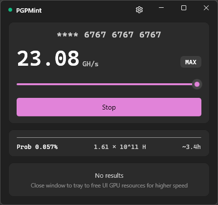
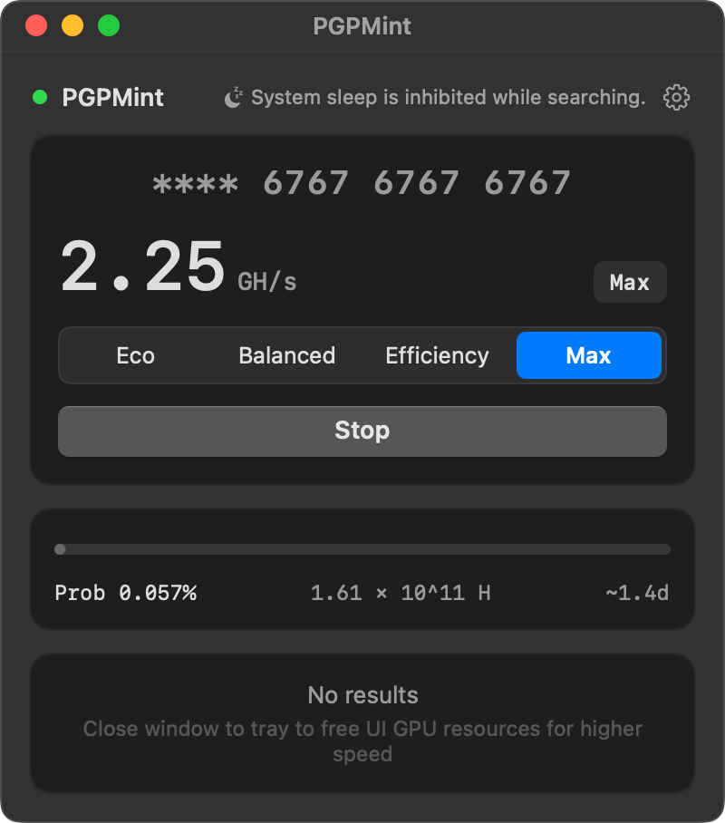
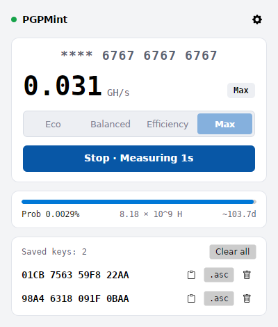

<div align="center">

# PGPMint

[English](README.md) | [繁體中文](README.zh-TW.md) | [简体中文](README.zh-CN.md) | 日本語

**Windows・macOS・Linux のネイティブアプリとクロスプラットフォーム CLI を備えた、OpenPGP v4（`Ed25519`）バニティ Key ID 向け高速 GPU ジェネレーター。**

[](https://github.com/Evanlau1798/PGPMint/actions/workflows/ci.yml)
[](https://github.com/Evanlau1798/PGPMint/releases)
[](LICENSE)
[](#対応プラットフォームと-cli)
[](#システム要件とビルド)

[主な機能](#主な機能) · [ベンチマーク](#ベンチマーク) · [クイックスタート](#ダウンロードとクイックスタート) · [Git 署名](#git-署名での利用) · [対応プラットフォームと CLI](#対応プラットフォームと-cli) · [システム要件とビルド](#システム要件とビルド)

<br />

<table>
  <tr>
    <td align="center" width="33%">
      <br />
      <sub><strong>Windows 11 (WinUI 3 + Mica)</strong></sub>
    </td>
    <td align="center" width="33%">
      <br />
      <sub><strong>macOS (ネイティブ SwiftUI / AppKit)</strong></sub>
    </td>
    <td align="center" width="33%">
      <br />
      <sub><strong>Linux (Avalonia 12.2.0 / X11)</strong></sub>
    </td>
  </tr>
</table>

*Windows、macOS、Linux でキャリブレーション済み電力モードを使い、カスタム OpenPGP v4 Key ID を探索する PGPMint。*

</div>

---

## 主な機能

PGPMint は完全オフライン・テレメトリなしで、16 桁の 16 進数 Key ID が任意パターンに一致する **OpenPGP v4（`Ed25519Legacy`）** 鍵を GPU で高速生成します。

- **セットアップ不要のマルチ GPU エンジン**：Windows 向け単一 `.exe` および macOS / Linux 向け自己完結パッケージで提供し、`Vulkan -> OpenCL -> DirectCompute` 自動フォールバックとネイティブ Apple `Metal` に対応。保存前に CPU 側の SHA-1 で全件二重検証します。
- **任意位置 `*` ワイルドカードと作成日時指定**：1–16 桁の末尾一致（`6767 6767 6767`）、前方一致（`DEAD************`）、中間 `*` ワイルドカード（`CAFE*123`）、および任意の UTC 作成日時範囲（7 日以上）に対応。
- **4 段階電力モードと NVML 温度ガード**：30 秒の実測キャリブレーション後に `省電力` / `バランス` / `効率` / `最大` をリアルタイム切替。3D アプリへの自動譲歩、NVML 消費電力・`MH/W` 計測、温度上限ガード（UI `70–90 C` / CLI `65–90 C`）を備えます。
- **クロスデバイス進捗・鍵同期（`.pgpmint-sync`）**：`SessionId` 台帳による重複加算なしの冪等同期（実行中セッションへのライブホットインポート対応）と Argon2id + AES-256-GCM 暗号化バンドルに対応。
- **暗号化保管庫と Git 対応 `.asc` 書き出し**：DPAPI / Argon2id によるローカル暗号化（最大 50 件）と RFC 9580 / GnuPG 互換エクスポート（`Certify | Sign`、既定で `Cv25519` 暗号化サブキー付与、有効期限・AES-256-CFB パスフレーズ対応）。
- **バックグラウンド常駐と 10 言語 UI**：トレイ／メニューバー最小化、スリープ抑止（`IOKit` / `systemd-inhibit`）、純 CPU Windows ミニ HUD、10 言語ビルトイン UI を搭載（CLI はスクリプト互換性のため英語固定）。

---

## ベンチマーク

`v4` 演算パイプラインにおける各種 GPU の実機連続探索速度（RTX 5090 / 3090 系は Linux 上で `libnvidia-ml.so.1` と 13 桁マスク `***1145141919810` を用いて計測；計算環境の謝辞は[謝辞とクラウド GPU 利用上の注意](#謝辞とクラウド-gpu-利用上の注意)を参照）：

| GPU / OS | バックエンド | 連続速度（最大） | 消費電力 / 電力効率 | 備考 |
|---|---|---|---|---|
| **RTX 5090 (Linux x64, 450 W 上限)** | **OpenCL** (`4x128`) | **76.18–77.67 GH/s** | `450.0 W` (**`172.61 MH/W`**) | マイクロベンチ最大 `83.93 GH/s` (`wg=64`)；180 秒安定 `74.70 GH/s` |
| **RTX 3090 x2 NVLink (Linux x64)** | **OpenCL** (`4x128`) | **49.43–50.41 GH/s** | `598.8 W` (`82.54 MH/W`) | デュアル合計 `600 W` 上限 (`2.03x` スケール)；60 秒安定 `46.42 GH/s` |
| **RTX 3090 (Linux x64)** | **OpenCL** (`4x128`) | **25.51–25.93 GH/s** | `298.7 W` (**`85.42 MH/W`**) | `300 W` 上限；60 秒 `25.10 GH/s @ 66–70 C` (`0/60` 熱制限なし) |
| **RTX 3080 (Windows 11 x64)** | **Vulkan** (`4x128`) | **22.51–23.23 GH/s** | `346.6 W` (`64.95 MH/W`) | OpenCL `23.19 GH/s`、D3D11 `14.38 GH/s` フォールバック |
| **Apple M3 (macOS 15.6.1)** | **MoltenVK** | **約 2.25 GH/s** | — | Apple Silicon ネイティブ サイドカー実測 |
| **Intel Alder Lake UHD (Rocky 9.8)** | **Vulkan** | **566.99 MH/s** 最大 | — | キャリブレーション中央値 `561.90 MH/s` (Mesa 25.2.7) |

<p align="center">
  
</p>

全 21 点の安定カーブ、60 秒 / 180 秒連続安定性ログ、バックエンド詳細比較は **[guides/benchmarks.md](guides/benchmarks.md)**（英語）にまとめています。

<details>
<summary><strong>表示：平均期待待機時間（20 GH/s 基準）</strong></summary>

| 固定一致桁数 | 探索空間（$16^k$） | 平均期待時間 |
|---:|---:|---:|
| 8 桁 | $4.29 \times 10^{9}$ | 約 0.2 秒 |
| 10 桁 | $1.10 \times 10^{12}$ | 約 55 秒 |
| 12 桁 | $2.81 \times 10^{14}$ | 約 3.9 時間 |
| 13 桁 | $4.50 \times 10^{15}$ | 約 2.6 日 |
| 14 桁 | $7.21 \times 10^{16}$ | 約 41.7 日 |

</details>

<details>
<summary><strong>表示：他ツールとの機能比較</strong></summary>

| 機能 | PGPMint | CUDA CLI ツール | OpenCL CLI ツール | WebGL/WebGPU ブラウザ |
|---|---|---|---|---|
| ネイティブ UI とトレイ／メニューバー | あり（WinUI 3 / SwiftUI / Avalonia） | なし | なし | ブラウザタブ（バックグラウンド制限） |
| Python / CUDA Toolkit 不要 | あり（単一ファイル / 自己完結） | CUDA 必須 | Runtime 必須 | あり |
| 汎用 GPU 自動フォールバック | Vulkan + OpenCL + DirectCompute / Metal | NVIDIA のみ | OpenCL ICD 必須 | ブラウザ依存 |
| マルチ GPU と電力効率モード | あり（`省電力` / `バランス` / `効率` / `最大`） | フル速度のみ | フル速度のみ | 限定的 |
| 暗号化保管庫と Git 対応 `.asc` 出力 | あり（DPAPI / Argon2id + 自己署名 + `Cv25519`） | 生データ出力 | 生データ出力 | 手動保存 |

</details>

---

## ダウンロードとクイックスタート

1. [GitHub Releases](https://github.com/Evanlau1798/PGPMint/releases) からプラットフォーム向けのファイルを取得します：
   - **Windows GUI**：`PGPMint-*-win-x64.exe` または `PGPMint-*-win-arm64.exe`（単一ポータブル `.exe`）
   - **Windows CLI**：`PGPMint-cli-*-win-x64.exe` または `PGPMint-cli-*-win-arm64.exe`（単一ポータブル `.exe`）
   - **macOS**：`PGPMint-*-macos-arm64.tar.gz` または `PGPMint-*-macos-x64.tar.gz`（`PGPMint.app` + CLI 同梱）
   - **Linux**：`PGPMint-*-linux-x64.tar.gz` または `PGPMint-*-linux-arm64.tar.gz`（`PGPMint.Desktop` + CLI 同梱）
2. **初期設定**：1–16 桁の 16 進数パターン（`0–9`、`A–F`、または `CAFE*123` のような `*` ワイルドカード）、使用 GPU、言語を選択します。
3. **自動キャリブレーションと探索**：開始すると必要に応じて 30 秒計測を実行し（計測中の一致も保存）、完了後は 4 段階電力切替・安全な停止・トレイ常駐が可能です。
4. **鍵のエクスポート**：結果一覧の `.asc` から `<KEYID>.secret.asc` と `<KEYID>.public.asc`（既定で `Cv25519` サブキー同梱）を保存します。

---

## Git 署名での利用

書き出した鍵には自己署名の User ID と `Certify | Sign`（`0x03`）が含まれ、GnuPG・Git・GitHub Verified 署名にそのまま利用できます：

```powershell
gpg --import <KEYID>.secret.asc
git config --global user.signingkey <KEYID>
git config --global commit.gpgsign true
# <KEYID>.public.asc の内容を GitHub -> Settings -> SSH and GPG keys に登録
```

---

## 対応プラットフォームと CLI

| ターゲット | UI / 実行形式 | GPU バックエンド | 保管庫の保護 | バックグラウンド・電力制御 |
|---|---|---|---|---|
| **Windows** (`x64` / `ARM64`) | ネイティブ WinUI 3 + Mica (`.exe`) | Vulkan -> OpenCL -> DirectCompute | DPAPI (`CurrentUser`) | ゼロ負荷トレイ + 純 CPU ミニ HUD |
| **macOS 14+** (`arm64` / `x64`) | SwiftUI / AppKit + `.NET 10` サイドカー | Metal + MoltenVK Vulkan | ログインキーチェーンまたはパスワード (Argon2id) | メニューバー速度表示 + `IOKit` スリープ抑止 |
| **Linux** (`x64` / `ARM64`) | Avalonia 12.2.0 XAML (`X11` / `XWayland`) | Vulkan + OpenCL | Argon2id + AES-256-GCM | `StatusNotifierWatcher` トレイ + `systemd-inhibit` |
| **CLI** (全 3 OS) | ヘッドレス実行ファイル (`pgpmint`) | 各 OS 準拠 | Argon2id + AES-256-GCM / キーチェーン | `--tier`、`--max-temp`、`--keep-running`、`sync`、`curve` |

<details>
<summary><strong>表示：macOS・Linux 導入時の注意（署名、キーチェーン、0700 / ACL、ドライバ）</strong></summary>

- **macOS 署名とパイプ分離**：配布アプリは ad-hoc 署名（未公証）のため、初回起動時に「システム設定 -> プライバシーとセキュリティ」で許可が必要な場合があります。UI は匿名 `stdin`/`stdout` パイプ経由で `pgpmint-host` と通信し、秘密鍵シードは UI プロセスへ渡されません。
- **macOS キーチェーンとバックアップ**：新規デスクトップ保管庫はログインキーチェーンで自動解除され、既存パスワード保管庫はパスワード維持となります。ディレクトリ全体（`vault.key.json` / `vault.unlock.json` とキーチェーン項目含む）のバックアップとパスフレーズ付き `.asc` 書き出しを推奨します。
- **Linux ドライバ要件**：同梱の `.NET` は GPU ドライバを代替しないため、ハードウェア Vulkan 1.1+ または OpenCL ICD ドライバが必要です（詳細ライブラリはアーカイブ内の `TESTING.txt` 参照）。CLI は X11 なしで動作します。
- **ディレクトリ権限と排他ロック**：Unix の独自保管庫ディレクトリは事前にモード `0700` である必要があり、macOS は ACL が設定されたパスを拒否します。デスクトップと CLI は排他 `VaultSession` で同時アクセスを防ぎます。

</details>

<details>
<summary><strong>表示：CLI クイックリファレンス（devices / verify / search / curve / sync / export）</strong></summary>

```sh
./pgpmint devices --json
./pgpmint verify --backend vulkan        # Windows、Linux Vulkan、または macOS MoltenVK
./pgpmint verify --backend metal         # macOS ネイティブ Metal
./pgpmint search --pattern "CAFE*123" --tier efficiency --max-temp 80 --keep-running
./pgpmint curve --backend opencl --pattern BEEF
./pgpmint sync export --output ./bundle.pgpmint-sync
./pgpmint export --key YOUR_KEY_ID --name "Your Name" --output ./exported
```

自動化では `--password-stdin` が利用可能です（1 行目に保管庫パスワード、2 行目に `export` パスフレーズ；macOS キーチェーン保管庫の `export` では 1 行目のみを `.asc` パスフレーズとして読み込みます）。

</details>

セキュリティ仕様、バックアップ規約、CLI 全オプションの詳細は **[guides/platforms-and-cli.md](guides/platforms-and-cli.md)**（英語）を参照してください。

---

## システム要件とビルド

- **Windows**：Windows 10（ビルド 19041 / 2004 以降）または Windows 11（`x64` / `ARM64`）、Direct3D 11 Feature Level 11.0+ 対応 GPU（Vulkan 1.1+ または OpenCL 推奨）。
- **macOS**：macOS 14 Sonoma 以降（`Apple Silicon arm64` / `Intel x64`）、Metal / MoltenVK 対応 GPU。
- **Linux**：X11 または XWayland セッション（CLI のみの場合は GUI 不要）とハードウェア Vulkan 1.1+ / OpenCL ICD ドライバ。

<details>
<summary><strong>表示：ソースからのビルドとパッケージ化（.NET 10 SDK）</strong></summary>

[.NET 10 SDK](https://dotnet.microsoft.com/download/dotnet/10.0) に加え、Windows では Windows 10/11 SDK（`10.0.26100.0`）、macOS では Xcode Command Line Tools が必要です：

```powershell
dotnet build PGPMint.sln -p:Platform=x64 -c Release
dotnet test tests\PGPMint.Tests\PGPMint.Tests.csproj -p:Platform=x64 -c Release --no-build --filter "Category!=HardwareGpu"
python scripts/packaging/package.py --rid win-x64 --tag v1.3.0 --platform x64 --scratch C:\pgpmint-dist
```

</details>

SHA-1 GPU パイプライン、キャリブレーションと `.pgpmint-sync` の仕組み、翻訳ファイル追加手順、全 6 プラットフォーム向けパッケージコマンドは **[guides/architecture-and-build.md](guides/architecture-and-build.md)**（英語）に記載しています。

---

## 謝辞とクラウド GPU 利用上の注意

本リポジトリにおける RTX 5090、RTX 3090、および RTX 3090 x2 NVLink のベンチマークと電力効率カーブ計測に GPU 計算環境を提供してくださった **[gputw.ai](https://gputw.ai)** に心より感謝いたします。

> [!WARNING]
> **クラウド・レンタル GPU におけるマイニング誤検知リスクについて**：PGPMint は OpenPGP Key ID 探索のため、長期間にわたり高負荷の GPU SHA-1 ハッシュ演算（`opencl-sha1-four-v5` / `vulkan-sha1-four-v5`）を実行します。その動作パターン・GPU 使用率・連続消費電力の挙動は**暗号資産マイニング（Proof-of-Work Mining）と極めて類似**しています。**事前にプロバイダの利用規約（Terms of Service / Acceptable Use Policy）の確認や許可を得ることなく、レンタル・クラウド GPU 上でそのまま長時間計算を開始しないでください**。自動化された不正利用・マイニング検知が作動し、**アカウント停止または凍結**につながるおそれがあります。

---

## コントリビュートとライセンス

Issue、翻訳、Pull Request を歓迎します。PR 前に Release ビルドとテスト通過、および絵文字が含まれないこと（CI チェック対象）をご確認ください。[MIT License](LICENSE) の下で公開されています。
