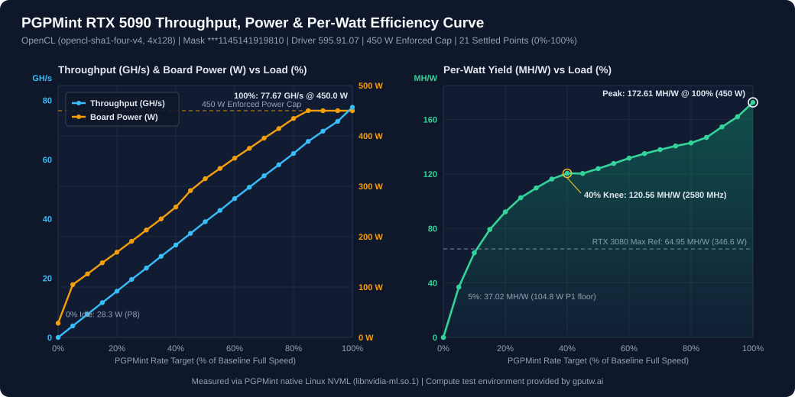

<div align="center">

# PGPMint

[English](README.md) | [繁體中文](README.zh-TW.md) | [简体中文](README.zh-CN.md) | 日本語

**Windows、macOS ネイティブ、Linux デスクトップアプリとクロスプラットフォーム CLI を備えた、OpenPGP v4（`Ed25519`）バニティ Key ID 向け高速 GPU ジェネレーター。**

[](https://github.com/Evanlau1798/PGPMint/actions/workflows/ci.yml)
[](https://github.com/Evanlau1798/PGPMint/releases)
[](LICENSE)
[](#システム要件)
[](#ソースからのビルド)

[ダウンロードとクイックスタート](#ダウンロードとクイックスタート) · [主な機能](#主な機能) · [Git 署名での利用](#エクスポートした鍵を-git-署名に使う) · [ベンチマーク](#ベンチマーク) · [ソースからのビルド](#ソースからのビルド)

<br />

<table>
  <tr>
    <td align="center" width="33%">
      <br />
      <sub><strong>Windows 11 (WinUI 3 + Mica)</strong></sub>
    </td>
    <td align="center" width="33%">
      <br />
      <sub><strong>macOS (ネイティブ SwiftUI / AppKit)</strong></sub>
    </td>
    <td align="center" width="33%">
      <br />
      <sub><strong>Linux (Avalonia 12.2.0 / X11)</strong></sub>
    </td>
  </tr>
</table>

*Windows、macOS、Linux でキャリブレーション済み電力モードを使い、カスタム OpenPGP v4 Key ID 末尾を探索する PGPMint。*

</div>

---

## PGPMint とは？

PGPMint は、GPU 演算を用いて 16 桁の 16 進数 Key ID の末尾が任意のパターン（例：`6767 6767 6767` や `0123 4567 89AB`）に一致する **OpenPGP v4（`Ed25519Legacy`）** 鍵を高速生成します。

Python や NVIDIA CUDA Toolkit の構築を要求する CLI ツールや、バックグラウンドでスロットリングされるブラウザ拡張とは異なり、PGPMint は **単一ファイルの Windows ポータブル実行形式**（GUI + CLI）と自己完結型の **macOS（`macos-arm64` / `macos-x64`）**・**Linux（`linux-x64` / `linux-arm64`）** パッケージとして配布され、電力効率モード、トレイ / メニューバー常駐、Git 署名対応の `.asc` エクスポートを備えています。

---

## 主な機能

### macOS・Linux デスクトップ版およびクロスプラットフォーム CLI

フラッグシップの Windows WinUI アプリ（`src/PGPMint.App`）に加え、macOS・Linux 版も統一された PGPMint ブランドアイコン（[assets/pgpmint-icon.svg](assets/pgpmint-icon.svg)）で刷新されました。

- **macOS（`src/PGPMint.MacApp` + `src/PGPMint.Host`）**：macOS 14 以降向けのネイティブ **SwiftUI + AppKit** アプリ（`macos-arm64` / `macos-x64`）。同梱の自己完結型 `.NET 10` サイドカー（`pgpmint-host`）と匿名の `stdin`/`stdout` NDJSON パイプで通信し、秘密鍵シードを UI プロセスへ一切渡しません。パイプ切断時には即座に GPU ワーカーを停止し排他 `VaultSession` を解放します。新規保管庫はログインキーチェーン自動解除に対応（既存のパスワード保管庫は元のパスワードを維持）、メニューバーでのリアルタイム速度表示と 4 段階電力切替、`IOKit` スリープ抑止、ネイティブ Metal（`libpgpmint_metal.dylib`）および MoltenVK Vulkan に対応します。テスト・配布アプリは ad-hoc 署名であり公証されていないため、初回起動時は macOS「システム設定」での許可が必要になる場合があります。
- **Linux（`src/PGPMint.Desktop`）**：初期設定ウィザード、3 カード構成のダッシュボード、独立した設定ウィンドウ、ホバー解説とネイティブ NVIDIA NVML（`libnvidia-ml.so.1`）による消費電力・`MH/W` 計測に対応した 4 段階電力モード（`省電力` / `バランス` / `効率` / `最大`）、`/usr/bin/systemd-inhibit` による無音スリープ抑止、`StatusNotifierWatcher` システムトレイ連携、ネイティブ Vulkan / OpenCL コンピュートバックエンドを備えた刷新版 **Avalonia 12.2.0** XAML アプリ（`linux-x64` / `linux-arm64`）。CPU ソフトウェアレンダラーは自動的に除外されます。
- **クロスプラットフォーム CLI（`src/PGPMint.Cli`）**：

```sh
# Windows は PGPMint-cli-*-win-x64.exe を直接実行、macOS / Linux は展開後に ./cli/pgpmint を実行
./pgpmint devices --json
./pgpmint verify --backend vulkan       # Linux ネイティブ Vulkan または macOS MoltenVK
./pgpmint verify --backend metal        # macOS ネイティブ Metal
./pgpmint benchmark --backend vulkan --seconds 60 --rounds 3
./pgpmint search --pattern BEEF
./pgpmint export --key YOUR_KEY_ID --name "Your Name" --output ./exported
```

CLI とポータブル保管庫は Argon2id + AES-256-GCM 暗号化と厳格なディレクトリ権限（Unix `0700` および macOS ACL 検証）を採用し、GPU が見つけたすべての候補は保存前に CPU 側の SHA-1 で二重検証されます。自動化用途では `--password-stdin` に対応しています。

### Windows アプリケーション

- **単一ファイル ポータブル実行形式**：`win-x64` と `win-arm64` 向けに圧縮された単体 `.exe`（GUI・CLI 個別）を提供。Python、CUDA Toolkit、.NET、Windows App Runtime の事前インストールは不要です。
- **3 層汎用 GPU 演算エンジン**：外部依存なしの自動フォールバック構成——ピーク性能を引き出すネイティブ **Vulkan Compute**（`vulkan-1.dll` + プログラム生成 SPIR-V 1.3、`vulkan-sha1-four-v4`）を最優先し、利用不可時は **`OpenCL.dll`**（`opencl-sha1-four-v4`）、さらに **DirectCompute**（`D3D11 cs_5_0`、`d3d11-sha1-four-v4`）へシームレスに切り替えます。マルチ GPU 並列探索に対応。
- **実測に基づく 4 段階電力モード**：探索パスグループ（`1–4` 桁、`5–8` 桁、`9–16` 桁）や GPU・ドライバ構成の変更時に 30 秒のフル効率カーブを自動計測し、`省電力` / `バランス` / `効率` / `最大` をリアルタイム切替。他の 3D アプリが高負荷になると自動で譲歩します。
- **ゼロ負荷システムトレイと純 CPU フローティング HUD**：メインウィンドウをトレイへ閉じると WinUI 3 の GPU 描画を解放し、オプションの純 CPU Direct2D/DirectWrite 製ミニ HUD が現在速度・確率・残り時間・進捗を表示します（フルスクリーンアプリ・ゲーム実行時は自動非表示）。
- **DPAPI 暗号化保管庫と `.asc` エクスポート**：秘密鍵シードは Windows DPAPI（`CurrentUser`）で暗号化保存され（最大 50 件）、RFC 9580 / GnuPG 互換の `.secret.asc` と `.public.asc`（`Certify | Sign` フラグ付き、任意で AES-256-CFB パスフレーズ保護）を書き出せます。
- **10 言語ビルトイン多言語対応**：3 プラットフォームすべてのデスクトップ UI で 10 の主要言語（`English`、`繁體中文`、`简体中文`、`日本語`、`한국어`、`Deutsch`、`Français`、`Español`、`Português (Brasil)`、`Русский`）を標準サポートし、Windows 版は `PGPMint.exe` と同階層の `Strings/*.json` による外部言語追加にも対応しています（CLI はスクリプト互換性のため英語固定）。

---

## ダウンロードとクイックスタート

1. [GitHub Releases](https://github.com/Evanlau1798/PGPMint/releases) からプラットフォーム向けのファイルを取得します：
   - **Windows GUI**：`PGPMint-*-win-x64.exe` または `PGPMint-*-win-arm64.exe`（単一ポータブル `.exe`）
   - **Windows CLI**：`PGPMint-cli-*-win-x64.exe` または `PGPMint-cli-*-win-arm64.exe`（単一ポータブル `.exe`）
   - **macOS**：`PGPMint-*-macos-arm64.tar.gz` または `PGPMint-*-macos-x64.tar.gz`（`PGPMint.app` + CLI 同梱）
   - **Linux**：`PGPMint-*-linux-x64.tar.gz` または `PGPMint-*-linux-arm64.tar.gz`（`PGPMint.Desktop` + CLI 同梱）
2. **初期設定**：狙いたい 1–16 桁の 16 進数 Key ID 末尾（`0–9`、`A–F`、例：`01 2345 6789`）、使用する GPU、言語を選択して完了します。
3. **自動キャリブレーションと探索**：開始すると必要に応じて 30 秒の計測を自動実行し（計測中の一致も保存されます）、その後 4 段階の電力モードを自由に切り替えられます。**停止**を押すと実行中のバッチ完了後に進捗を保存して待機状態へ戻ります。
4. **鍵のエクスポート**：結果一覧の `.asc` ボタンから `<KEYID>.secret.asc` と `<KEYID>.public.asc` を保存できます。

---

## エクスポートした鍵を Git 署名に使う

書き出した鍵には自己署名の User ID と `Certify | Sign`（`0x03`）フラグが含まれ、GnuPG・Git・GitHub Verified コミット署名にそのまま利用できます：

```powershell
# 1. 生成した秘密鍵を GnuPG にインポート
gpg --import <KEYID>.secret.asc

# 2. Git に署名用 Key ID を設定
git config --global user.signingkey <KEYID>
git config --global commit.gpgsign true

# 3. <KEYID>.public.asc の内容を GitHub -> Settings -> SSH and GPG keys に登録
```

---

## ベンチマーク

以下は **NVIDIA GeForce RTX 3080**（Windows 11 x64、WDDM ドライバ `32.0.16.1088`、Release x64、`最大` モード）における現行 v4 エンジンの実測値です（ホスト側 Ed25519 鍵生成、SHA-1 スケジュール事前計算、GPU ディスパッチ、リードバックを含む）：

| バックエンド | カーネル | 134M バッチ中央値 | 536M バッチ中央値 | エンドツーエンド Coordinator（最大） |
|---|---|---:|---:|---:|
| ネイティブ Vulkan（`vulkan-1.dll`） | `vulkan-sha1-four-v4`（`ubo-spirv-v4`） | **5.63–6.12 ms**（`21.93–23.82 GH/s`） | **23.11–23.14 ms**（`23.20–23.24 GH/s`） | **23.23 GH/s** |
| ネイティブ OpenCL（`OpenCL.dll`） | `opencl-sha1-four-v4`（`cmem0-v4`） | **5.68–6.27 ms**（`21.42–23.61 GH/s`） | **23.78–23.92 ms**（`22.44–22.58 GH/s`） | **23.19 GH/s** |
| DirectCompute（`D3D11 cs_5_0`） | `d3d11-sha1-four-v4`（`cb1-v4`） | **9.14–9.44 ms**（`14.21–14.69 GH/s`） | **37.33–37.38 ms**（`14.36–14.38 GH/s`） | フォールバック層 |

その他の実機検証済み環境：
- **Apple M3（macOS 15.6.1 `macos-arm64`）**：MoltenVK 実機約 **2.25 GH/s**
- **Intel Alder Lake UHD（`ADL GT2`、Rocky Linux 9.8 `linux-x64`、Mesa 25.2.7 Vulkan）**：実機キャリブレーション最大約 **566.99 MH/s**（中央値 **561.90 MH/s**）

### NVIDIA GeForce RTX 5090（Linux x64、450 W 電力制限）

**NVIDIA GeForce RTX 5090**（32 GiB VRAM、Ubuntu 22.04.5 LTS、ドライバ `595.91.07`、コンテナ側上限 **450.00 W**／定格 `575.00 W`）にて、`PGPMint v1.2.1`＋ネイティブ Linux NVML（`libnvidia-ml.so.1`）を使用し 13 桁サフィックス `***1145141919810` で実測した結果です（謝辞およびクラウド GPU 利用上の注意は[謝辞とクラウド GPU 利用上の注意](#謝辞とクラウド-gpu-利用上の注意)を参照）。

| GPU / 環境 | バックエンド | カーネル / Workgroup | Micro 中央値 | エンドツーエンド（最大） | 備考 |
|---|---|---|---:|---:|---|
| **RTX 5090 (450 W)** | **OpenCL** | `opencl-sha1-four-v4` / `64` | **83.93 GH/s** | **76.63 GH/s** | マイクロベンチ最高値 |
| **RTX 5090 (450 W)** | **OpenCL** | `opencl-sha1-four-v4` / `128` | **83.32 GH/s** | **76.18 GH/s** | CLI `search` 標準設定（`cmem0-v4`） |
| **RTX 5090 (450 W)** | **OpenCL** | `opencl-sha1-four-v4` / `256` | 81.60 GH/s | 75.97 GH/s | — |
| RTX 5090 (450 W) | Vulkan | `vulkan-sha1-four-v4` / `64`–`256` | 56.75–57.42 GH/s | 54.86–55.03 GH/s | ヘッドレス EGL ICD（`nvidia_egl_icd.json`） |
| RTX 3090 | OpenCL | `opencl-sha1-four-v4` / `128` | — | 24.97 GH/s | 以前の Linux コンテナ計測値 |
| RTX 3080 (Windows) | Vulkan | `vulkan-sha1-four-v4` / `128` | 23.20–23.82 GH/s | 22.51–23.23 GH/s | 全負荷 `346.61 W`（`64.95 MH/W`） |

<p align="center">
  
</p>

<details>
<summary><strong>RTX 5090 全 21 点安定状態カーブ（GH/s・W・MH/W）と 180 秒連続安定性データを表示（OpenCL, 4x128）</strong></summary>

各ステップ（`100%` は全速、`95%`–`5%` は PGPMint の 50 ms 周期スロットリング）で 3 秒間の安定待機後、NVML を約 100 ms 間隔で 5 秒間計測しています（`0%` は 5 秒間のアイドル計測）。すべてのステップで生成した候補数はそのまま探索進捗に加算されています。

| 目標負荷 | 実測速度 (GH/s) | 消費電力中央値 (W) | 電力効率 (MH/W) | GPU 使用率 (%) | コア / メモリクロック (MHz) | 温度 (C) | P-State | 電力制限フラグ |
|---:|---:|---:|---:|---:|---|---:|:---:|---|
| **100%** | **77.671** | **449.99** | **172.61** | 100 | 2460 / 13801 | 67 | P1 | `SwPowerCap(50/50)` |
| **95%** | 72.912 | 449.94 | 162.05 | 89 | 2610 / 13801 | 69 | P1 | `SwPowerCap(51/51)` |
| **90%** | 69.595 | 450.05 | 154.64 | 85 | 2640 / 13801 | 71 | P1 | `SwPowerCap(52/52)` |
| **85%** | 66.138 | 450.22 | 146.90 | 78 | 2685 / 13801 | 72 | P1 | `SwPowerCap(52/52)` |
| **80%** | 62.075 | 434.58 | 142.84 | 74 | 2707 / 13801 | 73 | P1 | `SwPowerCap(51/51)` |
| **75%** | 58.264 | 414.47 | 140.57 | 69 | 2715 / 13801 | 72 | P1 | `SwPowerCap(52/52)` |
| **70%** | 54.541 | 395.45 | 137.92 | 65 | 2722 / 13801 | 72 | P1 | `SwPowerCap(52/52)` |
| **65%** | 50.677 | 375.36 | 135.01 | 60 | 2737 / 13801 | 72 | P1 | `SwPowerCap(36/52)` |
| **60%** | 46.848 | 355.71 | 131.70 | 55 | 2745 / 13801 | 71 | P1 | `SwPowerCap(15/52)` |
| **55%** | 42.859 | 335.41 | 127.78 | 51 | 2752 / 13801 | 71 | P1 | `SwPowerCap(5/52)` |
| **50%** | 39.055 | 315.02 | 123.98 | 46 | 2767 / 13801 | 69 | P1 | `None` |
| **45%** | 35.103 | 291.53 | 120.41 | 40 | 2767 / 13801 | 70 | P1 | `None` |
| **40%** | 31.205 | 258.84 | 120.56 | 35 | 2580 / 13801 | 67 | P1 | `None` |
| **35%** | 27.370 | 235.32 | 116.31 | 32 | 2565 / 13801 | 65 | P1 | `None` |
| **30%** | 23.404 | 213.20 | 109.78 | 27 | 2550 / 13801 | 64 | P1 | `None` |
| **25%** | 19.584 | 190.85 | 102.61 | 23 | 2542 / 13801 | 61 | P1 | `None` |
| **20%** | 15.601 | 169.27 | 92.17 | 19 | 2527 / 13801 | 60 | P1 | `None` |
| **15%** | 11.745 | 148.12 | 79.30 | 13 | 2520 / 13801 | 58 | P1 | `None` |
| **10%** | 7.832 | 126.09 | 62.12 | 9 | 2505 / 13801 | 57 | P1 | `None` |
| **5%** | 3.879 | 104.79 | 37.02 | 5 | 2497 / 13801 | 55 | P1 | `None` |
| **0% (アイドル)** | 0.000 | 28.32 | — | 0 | 195 / 405 | 52 | P8 | `None` |

- **450 W 制限下で `100%`（最大）が最高効率（`172.61 MH/W`）となる理由**：450 W の上限により連続負荷時のコアクロックが効率の良い `2460 MHz` 帯へ抑えられ、RTX 3080（`64.95 MH/W`）の約 **2.66 倍**のワット当たり探索性能を発揮します。一方 50 ms スライス制限では GPU が `P1`（GDDR7 `13801 MHz`、5% でも `104.79 W`）に留まり、`85%–95%` 帯ではバースト昇圧（`2610–2685 MHz`）により 450 W 上限に達し続けるため効率が低下します。`40%` 地点でクロックが `2767 -> 2580 MHz` へ下がり、消費電力が `32.7 W` 低下して小さな効率屈曲点（`120.56 MH/W`）が現れます。
- **グラフ上の 4 モード動作点（`EfficiencyCurveSelector`）**：RTX 5090（高アイドル電力向け `Eco` 最適化適用）：`Eco`（`10%`）`7.83 GH/s @ 126.09 W`（`62.12 MH/W`）、`Balanced`（`40%`）`31.20 GH/s @ 258.84 W`（`120.56 MH/W`）、`Efficiency`（`70%`）`54.54 GH/s @ 395.45 W`（`137.92 MH/W`）、`Max`（`100%`）`77.67 GH/s @ 450.00 W`（`172.61 MH/W`）；RTX 3080（Windows Vulkan）：`Eco`（`11%`）`2.71 GH/s @ 56.47 W`（`48.03 MH/W`）、`Balanced`（`23%`）`5.39 GH/s @ 108.99 W`（`49.42 MH/W`）、`Efficiency`（`67%`）`15.88 GH/s @ 301.49 W`（`52.69 MH/W`）、`Max`（`100%`）`22.51 GH/s @ 346.61 W`（`64.95 MH/W`）。
- **4 段階電力モード実機検証（5 秒安定＋10 秒 `MultiGpuCoordinator`、v1.2.1 基準）**：`最大` `76.680 GH/s @ 449.99 W`（`170.40 MH/W`）、`効率`（`62.6%`）`49.743 GH/s @ 362.77 W`（`137.12 MH/W`）、`バランス`（`31.3%`）`24.242 GH/s @ 217.69 W`（`111.36 MH/W`）、`省電力`（`7.7%`）`6.136 GH/s @ 115.89 W`（`52.95 MH/W`）。
- **180 秒連続安定性（`Max`）**：平均 **`74.695 GH/s`**（中央値 **`74.726 GH/s`**、UI 平滑表示 `76.1 -> 74.4 GH/s`）、平均消費電力 **`448.71 W`**（**`166.47 MH/W`**）、温度は `70 C -> 80 C` で平衡（熱スロットリング `0/180`、`SwPowerCap` `179/180`）。

</details>

### 平均期待待機時間（20 GH/s 基準）

| 末尾長 | 探索空間（$16^k$） | 平均期待時間 |
|---:|---:|---:|
| 8 桁 | $4.29 \times 10^{9}$ | 約 0.2 秒 |
| 10 桁 | $1.10 \times 10^{12}$ | 約 55 秒 |
| 12 桁 | $2.81 \times 10^{14}$ | 約 3.9 時間 |
| 13 桁 | $4.50 \times 10^{15}$ | 約 2.6 日 |
| 14 桁 | $7.21 \times 10^{16}$ | 約 41.7 日 |

### 他ツールとの比較

| 機能 | PGPMint | CUDA CLI ツール | OpenCL CLI ツール | WebGL/WebGPU ブラウザ |
|---|---|---|---|---|
| ネイティブデスクトップ UI とトレイ | あり（WinUI 3 / SwiftUI / Avalonia） | なし | なし | ブラウザタブ（バックグラウンドで制限） |
| Python / CUDA Toolkit 不要 | あり（単一ファイル / 自己完結） | CUDA 必須 | Runtime 必須 | あり |
| 汎用 GPU 自動フォールバック | Vulkan + OpenCL + DirectCompute / Metal | NVIDIA のみ | OpenCL ICD 必須 | ブラウザ依存 |
| マルチ GPU と電力効率モード | あり（`省電力` / `バランス` / `効率` / `最大`） | フル速度のみ | フル速度のみ | 限定的 |
| 暗号化保管庫と Git 対応 `.asc` 出力 | あり（DPAPI / Argon2id + 自己署名） | 生データ出力 | 生データ出力 | 手動保存 |

---

## システム要件

- **Windows**：Windows 10（ビルド 19041 / 2004 以降）または Windows 11（`x64` / `ARM64`）、Direct3D 11 Feature Level 11.0+ 対応ハードウェア GPU（最高速度には Vulkan 1.1+ または OpenCL ドライバを推奨）。
- **macOS**：macOS 14 Sonoma 以降（`Apple Silicon arm64` または `Intel x64`）、Metal / MoltenVK 対応ハードウェア GPU。
- **Linux**：X11 または XWayland セッションと Vulkan 1.1+ / OpenCL ICD ハードウェアドライバ（CLI のみの場合は GUI 不要；必要ライブラリはアーカイブ内の `TESTING.txt` を参照）。

---

## ソースからのビルド

必要な環境：
- [.NET 10 SDK](https://dotnet.microsoft.com/download/dotnet/10.0)
- Windows 10/11 SDK（`10.0.26100.0`、Windows で `PGPMint.App` をビルドする場合）または Xcode Command Line Tools（macOS で `PGPMint.MacApp` をビルドする場合）

```powershell
# 全テストスイートを実行（実機 GPU および GnuPG / git commit -S テストを含む）
dotnet test tests\PGPMint.Tests\PGPMint.Tests.csproj -p:Platform=x64

# ビルド後にヘッドレス CI テストを実行（HardwareGpu カテゴリを除外）
dotnet build PGPMint.sln -p:Platform=x64 -c Release
dotnet test tests\PGPMint.Tests\PGPMint.Tests.csproj -p:Platform=x64 -c Release --no-build --filter "Category!=HardwareGpu"

# クロスプラットフォーム パッケージング スクリプトで配布アーカイブを生成
python scripts/packaging/package.py --rid win-x64 --tag v1.2.1 --platform x64 --scratch C:\pgpmint-dist
```

---

## 謝辞とクラウド GPU 利用上の注意

本リポジトリにおける RTX 5090（および従来の RTX 3090）のベンチマークと電力効率カーブ計測に GPU 計算環境を提供してくださった **[gputw.ai](https://gputw.ai)** に心より感謝いたします。

> [!WARNING]
> **クラウド・レンタル GPU におけるマイニング誤検知リスクについて**：PGPMint は OpenPGP Key ID 探索のため、長期間にわたり高負荷の GPU SHA-1 ハッシュ演算（`opencl-sha1-four-v4` / `vulkan-sha1-four-v4`）を実行します。その動作パターン・GPU 使用率・連続消費電力の挙動は**暗号資産マイニング（Proof-of-Work Mining）と極めて類似**しています。**事前にプロバイダの利用規約（Terms of Service / Acceptable Use Policy）の確認や許可を得ることなく、レンタル・クラウド GPU 上でそのまま長時間計算を開始しないでください**。自動化された不正利用・マイニング検知が作動し、**アカウント停止または凍結**につながるおそれがあります。

---

## コントリビュート

Issue、翻訳の追加、Pull Request を歓迎します。PR を送る前に `PGPMint.sln` のテストと Release ビルドが通過することを確認し、ソースコードやドキュメントに絵文字を含めないでください（CI で自動チェックされます）。

## ライセンス

[MIT License](LICENSE) の下で公開されています。
