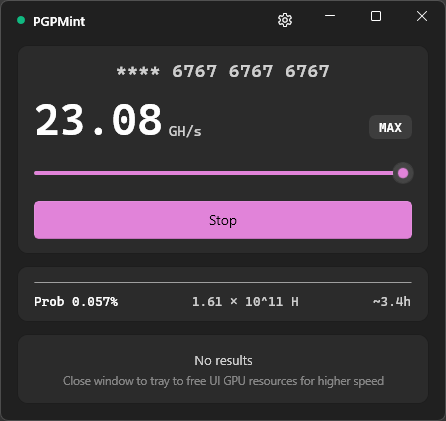
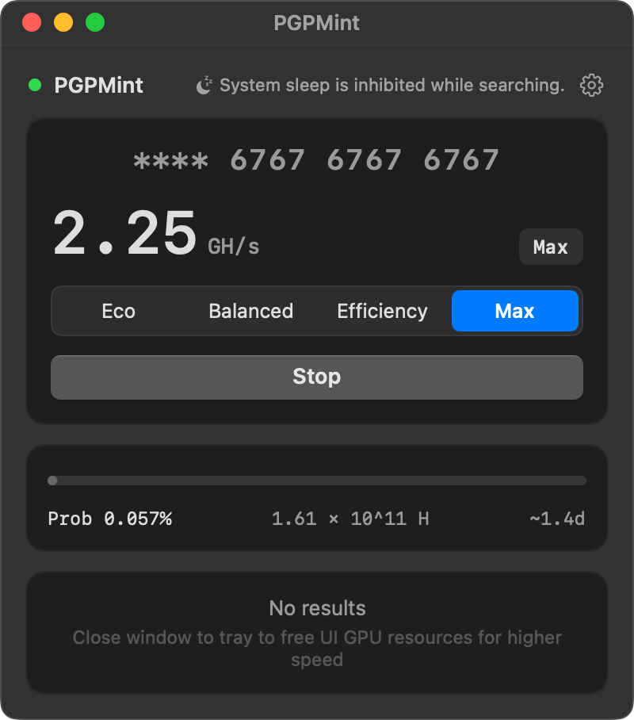
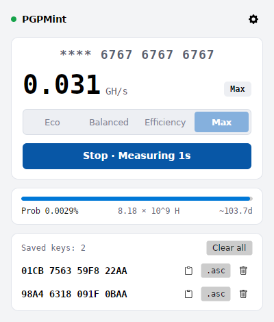
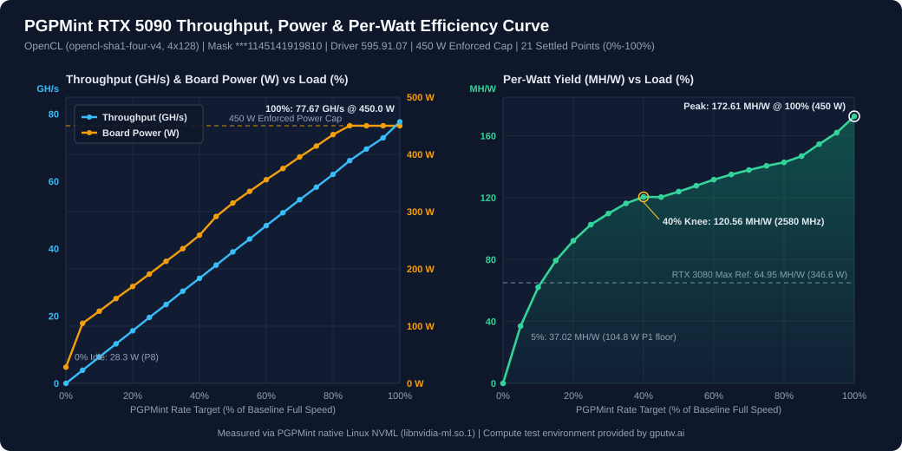

<div align="center">

# PGPMint

English | [繁體中文](README.zh-TW.md) | [简体中文](README.zh-CN.md) | [日本語](README.ja.md)

**GPU generator for custom OpenPGP v4 (`Ed25519`) vanity Key IDs, with native Windows, macOS, and Linux desktop apps plus a cross-platform CLI.**

[](https://github.com/Evanlau1798/PGPMint/actions/workflows/ci.yml)
[](https://github.com/Evanlau1798/PGPMint/releases)
[](LICENSE)
[](#platforms--cli)
[](#system-requirements--build)

[Features](#core-features) · [Benchmarks](#benchmarks) · [Quick Start](#download--quick-start) · [Git Signing](#using-exported-keys-with-git) · [Platforms & CLI](#platforms--cli) · [Build](#system-requirements--build)

<br />

<table>
  <tr>
    <td align="center" width="33%">
      <br />
      <sub><strong>Windows 11 (WinUI 3 + Mica)</strong></sub>
    </td>
    <td align="center" width="33%">
      <br />
      <sub><strong>macOS (Native SwiftUI / AppKit)</strong></sub>
    </td>
    <td align="center" width="33%">
      <br />
      <sub><strong>Linux (Avalonia 12.2.0 / X11)</strong></sub>
    </td>
  </tr>
</table>

*PGPMint minting custom OpenPGP v4 Key IDs across Windows, macOS, and Linux with calibrated power tiers.*

</div>

---

## Core Features

PGPMint generates **OpenPGP v4 (`Ed25519Legacy`)** keys whose 16-character Key ID matches any hexadecimal pattern—completely offline with zero telemetry.

- **Zero-Setup Multi-GPU Engine**: Ships standalone single-file `.exe` (Windows) and self-contained macOS/Linux bundles with automatic `Vulkan -> OpenCL -> DirectCompute` fallback and native Apple `Metal`, plus mandatory CPU SHA-1 verification before saving.
- **Flexible `*` Wildcards & Creation Range**: Supports 1–16 hex suffixes (`6767 6767 6767`), prefixes (`DEAD************`), arbitrary mid-string `*` wildcards (`CAFE*123`), and optional UTC creation timestamp bounds (`>= 7` days).
- **4 Power Tiers & NVML Thermal Guard**: Automatically runs a 30 s efficiency sweep to unlock `Eco`, `Balanced`, `Efficiency`, and `Max`, with elastic yielding to 3D apps, live NVML board power (`W`, `MH/W`), and closed-loop thermal limits (`70–90 C` UI / `65–90 C` CLI).
- **Cross-Machine `.pgpmint-sync` Bundles**: `SessionId`-keyed idempotent progress ledger (safe repeated imports and live hot-import into active searches) paired with Argon2id + AES-256-GCM encrypted key bundles.
- **Encrypted Vault & Git-Ready `.asc` Export**: Local DPAPI / Argon2id encrypted storage (up to 50 keys) and RFC 9580 / GnuPG exports (`Certify | Sign`, default `Cv25519` encryption subkey, optional `--expires` and AES-256-CFB passphrase).
- **Background Keep-Alive & 10 Languages**: Tray / menu bar minimization, OS sleep inhibition (`IOKit` / `systemd-inhibit`), pure-CPU Windows floating Mini HUD, and 10 built-in UI languages (CLI stays English for consistent scripting).

---

## Benchmarks

End-to-end sustained `Max`-tier throughput across physical GPUs on the `v4` compute pipeline (`13`-hex suffix `***1145141919810` on RTX 5090 / 3090 with `libnvidia-ml.so.1`; see [Acknowledgements & Cloud GPU Usage Notice](#acknowledgements--cloud-gpu-usage-notice)):

| Device / OS | Backend | Sustained Speed (`Max`) | Power / Efficiency | Notes |
|---|---|---|---|---|
| **RTX 5090 (Linux x64, 450 W Cap)** | **OpenCL** (`4x128`) | **76.18–77.67 GH/s** | `450.0 W` (**`172.61 MH/W`**) | `83.93 GH/s` micro peak (`wg=64`); `74.70 GH/s` 180s steady |
| **RTX 3090 x2 NVLink (Linux x64)** | **OpenCL** (`4x128`) | **49.43–50.41 GH/s** | `598.8 W` (`82.54 MH/W`) | Dual `300 W` cap (`2.03x` scaling); `46.42 GH/s` 60s steady |
| **RTX 3090 (Linux x64)** | **OpenCL** (`4x128`) | **25.51–25.93 GH/s** | `298.7 W` (**`85.42 MH/W`**) | `300 W` cap; `25.10 GH/s @ 66–70 C` (`0/60` thermal throttle) |
| **RTX 3080 (Windows 11 x64)** | **Vulkan** (`4x128`) | **22.51–23.23 GH/s** | `346.6 W` (`64.95 MH/W`) | OpenCL `23.19 GH/s`, D3D11 `14.38 GH/s` fallback |
| **Apple M3 (macOS 15.6.1)** | **MoltenVK** | **~2.25 GH/s** | — | Native SwiftUI sidecar on Apple Silicon |
| **Intel Alder Lake UHD (Rocky 9.8)** | **Vulkan** | **566.99 MH/s** peak | — | `561.90 MH/s` median calibrated (Mesa 25.2.7) |

<p align="center">
  
</p>

Full 21-point settled curves, 60s/180s stability logs, and kernel evolution details are archived in **[guides/benchmarks.md](guides/benchmarks.md)**.

<details>
<summary><strong>Expected Average Wait Time (at 20 GH/s)</strong></summary>

| Pattern Fixed Length | Search Space ($16^k$) | Expected Average Time |
|---:|---:|---:|
| 8 hex chars | $4.29 \times 10^{9}$ | ~0.2 s |
| 10 hex chars | $1.10 \times 10^{12}$ | ~55 s |
| 12 hex chars | $2.81 \times 10^{14}$ | ~3.9 hours |
| 13 hex chars | $4.50 \times 10^{15}$ | ~2.6 days |
| 14 hex chars | $7.21 \times 10^{16}$ | ~41.7 days |

</details>

<details>
<summary><strong>Comparison with Alternatives</strong></summary>

| Capability | PGPMint | CLI CUDA Tools | CLI OpenCL Tools | Browser WebGL/WebGPU |
|---|---|---|---|---|
| Native Desktop UI & Tray / Menu Bar | Yes (WinUI 3 / SwiftUI / Avalonia) | No | No | Browser tab (throttled in background) |
| Zero Python / CUDA Toolkit Setup | Yes (standalone exe / self-contained) | Requires CUDA | Requires runtime | Yes |
| Universal GPU Backend Fallback | Vulkan + OpenCL + DirectCompute / Metal | NVIDIA only | Needs OpenCL ICD | Browser dependent |
| Multi-GPU + Power-Efficiency Tiers | Yes (`Eco` / `Balanced` / `Efficiency` / `Max`) | Full speed only | Full speed only | Limited |
| Encrypted Vault + Git-Ready `.asc` | Yes (DPAPI / Argon2id + self-sig + `Cv25519`) | Raw export | Raw export | Manual download |

</details>

---

## Download & Quick Start

1. Download the release asset for your platform from [GitHub Releases](https://github.com/Evanlau1798/PGPMint/releases):
   - **Windows GUI**: `PGPMint-*-win-x64.exe` or `PGPMint-*-win-arm64.exe` (single portable `.exe`)
   - **Windows CLI**: `PGPMint-cli-*-win-x64.exe` or `PGPMint-cli-*-win-arm64.exe` (single portable `.exe`)
   - **macOS**: `PGPMint-*-macos-arm64.tar.gz` or `PGPMint-*-macos-x64.tar.gz` (`PGPMint.app` + CLI)
   - **Linux**: `PGPMint-*-linux-x64.tar.gz` or `PGPMint-*-linux-arm64.tar.gz` (`PGPMint.Desktop` + CLI)
2. **Initial Setup**: Enter your target 1–16 hex Key ID pattern (`0–9`, `A–F`, or `*` wildcards such as `CAFE*123`), choose hardware GPU(s), and select your language.
3. **Auto Calibration & Search**: Start searching; PGPMint runs a 30 s calibration sweep when needed (matches found during calibration are still verified and saved). Switch live between `Eco`, `Balanced`, `Efficiency`, and `Max`, press **Stop** to save progress after the active batch, or close to tray / menu bar.
4. **Export Your Key**: Click `.asc` on a saved result to export `<KEYID>.secret.asc` and `<KEYID>.public.asc` (includes a `Cv25519` encryption subkey by default).

---

## Using Exported Keys with Git

Exported keys include a self-signed User ID (`Certify | Sign`, `0x03`) ready for GnuPG, Git, and GitHub Verified commits:

```powershell
gpg --import <KEYID>.secret.asc
git config --global user.signingkey <KEYID>
git config --global commit.gpgsign true
# Paste <KEYID>.public.asc into GitHub -> Settings -> SSH and GPG keys
```

---

## Platforms & CLI

| Target | UI / Runtime | GPU Backends | Vault Protection | Background & Power Control |
|---|---|---|---|---|
| **Windows** (`x64` / `ARM64`) | Native WinUI 3 + Mica (`.exe`) | Vulkan -> OpenCL -> DirectCompute | DPAPI (`CurrentUser`) | System tray + pure-CPU Mini HUD |
| **macOS 14+** (`arm64` / `x64`) | SwiftUI / AppKit + `.NET 10` sidecar | Metal + MoltenVK Vulkan | Login Keychain or Password (Argon2id) | Menu bar live rate + `IOKit` sleep block |
| **Linux** (`x64` / `ARM64`) | Avalonia 12.2.0 XAML (`X11` / `XWayland`) | Vulkan + OpenCL | Argon2id + AES-256-GCM | `StatusNotifierWatcher` tray + `systemd-inhibit` |
| **CLI** (All 3 OS) | Headless `.NET 10` binary (`pgpmint`) | Same per OS | Argon2id + AES-256-GCM / Keychain | `--tier`, `--max-temp`, `--keep-running`, `sync`, `curve` |

<details>
<summary><strong>macOS &amp; Linux Setup Notes (Signing, Keychain, Permissions &amp; Drivers)</strong></summary>

- **macOS Gatekeeper & Sidecar**: Packages are ad-hoc signed (not notarized); first launch may require allowing execution in **System Settings -> Privacy & Security**. The UI communicates over an isolated `stdin`/`stdout` pipe with `pgpmint-host` so private seeds never reach the UI process.
- **macOS Keychain & Backup**: New macOS desktop vaults unlock via your Login Keychain; existing password vaults remain password-protected. Back up the full vault directory (plus Login Keychain secret) and export passphrase-protected `.asc` files for portable recovery.
- **Linux Runtime & Drivers**: Bundled `.NET` does not replace hardware GPU drivers (Vulkan 1.1+ or OpenCL ICD is required; see `TESTING.txt` inside the archive; software CPU renderers are excluded). Headless CLI runs do not require X11/XWayland.
- **Directory Permissions & Isolation**: On Unix, custom vault directories must already use mode `0700`; macOS rejects vault/export paths with explicit or inherited ACLs. Desktop and CLI enforce an exclusive `VaultSession` lock (`%LOCALAPPDATA%\PGPMint-Portable\` separates Windows CLI/Avalonia vaults from WinUI's DPAPI vault).

</details>

<details>
<summary><strong>CLI Quick Reference (devices, verify, search, curve, sync, export)</strong></summary>

```sh
./pgpmint devices --json
./pgpmint verify --backend vulkan        # Windows, Linux Vulkan, or macOS MoltenVK
./pgpmint verify --backend metal         # macOS native Metal
./pgpmint search --pattern "CAFE*123" --tier efficiency --max-temp 80 --keep-running
./pgpmint curve --backend opencl --pattern BEEF
./pgpmint sync export --output ./bundle.pgpmint-sync
./pgpmint export --key YOUR_KEY_ID --name "Your Name" --output ./exported
```

For headless scripts, `--password-stdin` reads the vault password on line 1 and export passphrase on line 2 (`export` on a macOS keychain vault reads only line 1). Never pass passwords as CLI flags.

</details>

For full security rules, permission contracts, and all CLI flags, see **[guides/platforms-and-cli.md](guides/platforms-and-cli.md)**.

---

## System Requirements & Build

- **Windows**: Windows 10 (build 19041 / 2004+) or Windows 11 (`x64` / `ARM64`), Direct3D 11 Feature Level 11.0+ GPU (Vulkan 1.1+ / OpenCL recommended).
- **macOS**: macOS 14 Sonoma+ (`Apple Silicon arm64` or `Intel x64`) with Metal / MoltenVK GPU support.
- **Linux**: X11 or XWayland session (CLI headless OK) with hardware Vulkan 1.1+ or OpenCL ICD GPU drivers.

<details>
<summary><strong>Building &amp; Packaging from Source (.NET 10 SDK)</strong></summary>

Requires [.NET 10 SDK](https://dotnet.microsoft.com/download/dotnet/10.0) plus Windows 10/11 SDK (`10.0.26100.0`) on Windows or Xcode Command Line Tools on macOS:

```powershell
dotnet build PGPMint.sln -p:Platform=x64 -c Release
dotnet test tests\PGPMint.Tests\PGPMint.Tests.csproj -p:Platform=x64 -c Release --no-build --filter "Category!=HardwareGpu"
python scripts/packaging/package.py --rid win-x64 --tag v1.3.0 --platform x64 --scratch C:\pgpmint-dist
```

</details>

SHA-1 GPU pipeline internals, calibration logic, `.pgpmint-sync` design, custom translations, and full 6-platform packaging commands are documented in **[guides/architecture-and-build.md](guides/architecture-and-build.md)**.

---

## Acknowledgements & Cloud GPU Usage Notice

Special thanks to **[gputw.ai](https://gputw.ai)** for providing the GPU compute resources used for the RTX 5090, RTX 3090, and RTX 3090 x2 NVLink benchmark and power-efficiency curve testing in this repository.

> [!WARNING]
> **Cloud / Rented GPU Anti-Mining Risk Notice**: PGPMint performs sustained, compute-bound GPU SHA-1 hashing (`opencl-sha1-four-v5` / `vulkan-sha1-four-v5`). To cloud infrastructure telemetry and automated abuse-detection systems, its GPU utilization, clock profile, and continuous board power draw closely resemble cryptocurrency proof-of-work mining. **Do not start continuous PGPMint workloads on rented or cloud GPU instances without first reviewing the provider's Terms of Service / Acceptable Use Policy and obtaining explicit confirmation where required**, as unverified prolonged runs may trigger automated anti-mining enforcement and result in account suspension or termination.

---

## Contributing & License

Issues, translations, and pull requests are welcome; ensure Release builds and tests pass cleanly and keep tracked files free of emojis (enforced by CI). Released under the [MIT License](LICENSE).
