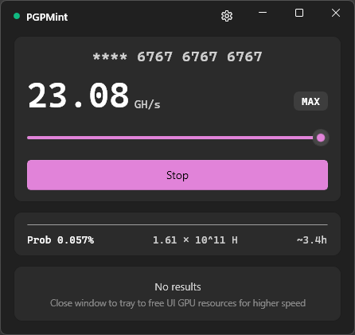
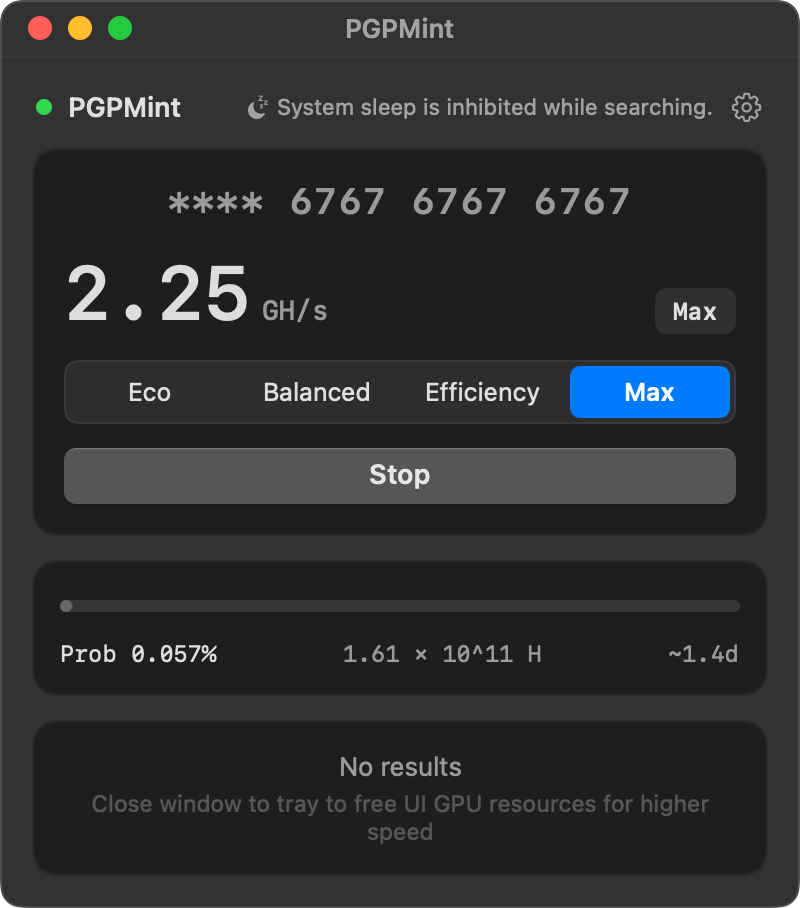
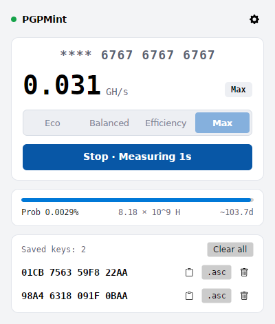
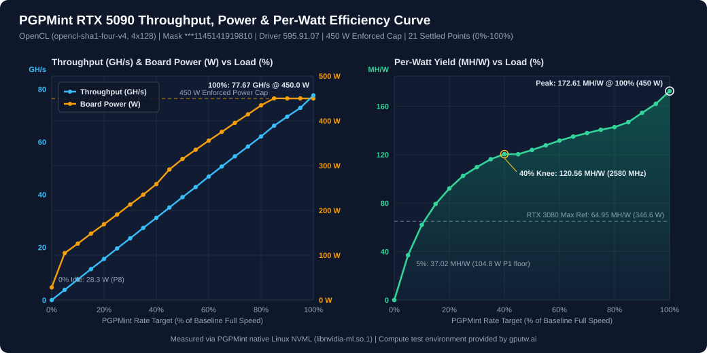

<div align="center">

# PGPMint

[English](README.md) | [繁體中文](README.zh-TW.md) | 简体中文 | [日本語](README.ja.md)

**使用显卡算力生成自定义样式的 OpenPGP v4（`Ed25519`）个性化 Key ID，提供 Windows、macOS、Linux 原生桌面应用与跨平台命令行工具。**

[](https://github.com/Evanlau1798/PGPMint/actions/workflows/ci.yml)
[](https://github.com/Evanlau1798/PGPMint/releases)
[](LICENSE)
[](#支持平台与-cli)
[](#系统需求与构建)

[核心特性](#核心特性) · [性能与功耗基准](#性能与功耗基准) · [下载与快速上手](#下载与快速上手) · [Git 签名](#搭配-git-签名) · [支持平台与 CLI](#支持平台与-cli) · [系统需求与构建](#系统需求与构建)

<br />

<table>
  <tr>
    <td align="center" width="33%">
      <br />
      <sub><strong>Windows 11（WinUI 3 + Mica）</strong></sub>
    </td>
    <td align="center" width="33%">
      <br />
      <sub><strong>macOS（原生 SwiftUI / AppKit）</strong></sub>
    </td>
    <td align="center" width="33%">
      <br />
      <sub><strong>Linux（Avalonia 12.2.0 / X11）</strong></sub>
    </td>
  </tr>
</table>

*PGPMint 在 Windows、macOS 和 Linux 上使用显卡搜索自定义 OpenPGP v4 Key ID 并支持校准功耗档位。*

</div>

---

## 核心特性

PGPMint 利用显卡高速生成 **OpenPGP v4（`Ed25519Legacy`）** 密钥，使 16 位十六进制 Key ID 匹配任意指定样式——全程本地离线运行、零遥测上传。

- **免环境配置的多显卡通用引擎**：提供 Windows 免安装单文件 `.exe` 与 macOS / Linux 自包含发行包，支持 `Vulkan -> OpenCL -> DirectCompute` 自动回退及原生 Apple `Metal`，每次命中均在 CPU 完成 SHA-1 双重校验。
- **任意位置 `*` 通配符与时间区间**：支持 1–16 位后缀（`6767 6767 6767`）、前缀（`DEAD************`）、中间 `*` 通配符（`CAFE*123`）以及可选 UTC 创建时间范围（跨度至少 7 天）。
- **四档实测功耗与 NVML 软限温**：自动完成 30 秒全曲线测量后可实时切换 `Eco` / `Balanced` / `Efficiency` / `Max`，支持对 3D 应用弹性让道、NVML 实时功耗遥测（`W`、`MH/W`）及闭环温控（桌面 `70–90 C` / CLI `65–90 C`）。
- **跨机进度与密钥加密同步（`.pgpmint-sync`）**：基于 `SessionId` 累计账本实现幂等进度导入（支持向运行中的搜索实时热导入且重复导入不重复累加），结合 Argon2id + AES-256-GCM 加密打包命中密钥。
- **加密密钥库与 Git 就绪 `.asc` 导出**：本地采用 DPAPI / Argon2id 加密保存（上限 50 条），可导出兼容 RFC 9580 / GnuPG 的文件（`Certify | Sign`，默认附带 `Cv25519` 加密子密钥，支持到期日与 AES-256-CFB 密码）。
- **后台驻留与 10 种语言**：支持系统托盘／菜单栏后台运行、防休眠锁（`IOKit` / `systemd-inhibit`）、Windows 纯 CPU 悬浮微窗以及 10 种内置界面语言（CLI 保持英文以确保脚本一致性）。

---

## 性能与功耗基准

各平台显卡在 `v4` 计算管线上的持续实测算力（RTX 5090 与 RTX 3090 系列均在 Linux 配合 `libnvidia-ml.so.1` 以 13 位掩码 `***1145141919810` 测得；算力致谢见[致谢与云端 GPU 使用警示](#致谢与云端-gpu-使用警示)）：

| 设备 / 操作系统 | 后端 | 持续算力（Max） | 功耗 / 每瓦能效 | 备注 |
|---|---|---|---|---|
| **RTX 5090（Linux x64，450 W 上限）** | **OpenCL**（`4x128`） | **76.18–77.67 GH/s** | `450.0 W`（**`172.61 MH/W`**） | 微基准峰值 `83.93 GH/s`（`wg=64`）；180 秒稳态 `74.70 GH/s` |
| **RTX 3090 x2 NVLink（Linux x64）** | **OpenCL**（`4x128`） | **49.43–50.41 GH/s** | `598.8 W`（`82.54 MH/W`） | 双卡合计 `600 W` 上限（`2.03x` 扩展）；60 秒稳态 `46.42 GH/s` |
| **RTX 3090（Linux x64）** | **OpenCL**（`4x128`） | **25.51–25.93 GH/s** | `298.7 W`（**`85.42 MH/W`**） | `300 W` 上限；60 秒 `25.10 GH/s @ 66–70 C`（`0/60` 热降频） |
| **RTX 3080（Windows 11 x64）** | **Vulkan**（`4x128`） | **22.51–23.23 GH/s** | `346.6 W`（`64.95 MH/W`） | OpenCL `23.19 GH/s`、D3D11 `14.38 GH/s` 回退 |
| **Apple M3（macOS 15.6.1）** | **MoltenVK** | **约 2.25 GH/s** | — | Apple Silicon 原生侧载助手实测 |
| **Intel Alder Lake UHD（Rocky 9.8）** | **Vulkan** | **566.99 MH/s** 峰值 | — | 校准中位数 `561.90 MH/s`（Mesa 25.2.7） |

<p align="center">
  
</p>

完整 21 点稳态曲线、60 秒 / 180 秒稳定性记录及各代内核演化详情参阅 **[guides/benchmarks.md](guides/benchmarks.md)**（英文）。

<details>
<summary><strong>展开查看：预期平均等待时间（按 20 GH/s 估算）</strong></summary>

| 固定匹配长度 | 搜索空间（$16^k$） | 预期平均时间 |
|---:|---:|---:|
| 8 位 | $4.29 \times 10^{9}$ | ~0.2 秒 |
| 10 位 | $1.10 \times 10^{12}$ | ~55 秒 |
| 12 位 | $2.81 \times 10^{14}$ | ~3.9 小时 |
| 13 位 | $4.50 \times 10^{15}$ | ~2.6 天 |
| 14 位 | $7.21 \times 10^{16}$ | ~41.7 天 |

</details>

<details>
<summary><strong>展开查看：与其他方案功能对比</strong></summary>

| 特性 | PGPMint | CLI CUDA 工具 | CLI OpenCL 工具 | 浏览器 WebGL/WebGPU |
|---|---|---|---|---|
| 原生桌面 UI 与系统托盘／菜单栏 | 是（WinUI 3 / SwiftUI / Avalonia） | 否 | 否 | 浏览器标签页（后台限速） |
| 免装 Python / CUDA Toolkit | 是（单文件 / 自包含包） | 需装 CUDA | 需装 Runtime | 是 |
| 通用显卡自动回退 | Vulkan + OpenCL + DirectCompute / Metal | 仅 NVIDIA | 需 OpenCL ICD | 依赖浏览器支持 |
| 多显卡＋功耗效率档位 | 是（`Eco` / `Balanced` / `Efficiency` / `Max`） | 仅全速 | 仅全速 | 有限 |
| 加密密钥库与 Git 就绪 `.asc` | 是（DPAPI / Argon2id + 自签名 + `Cv25519`） | 原始导出 | 原始导出 | 手动下载 |

</details>

---

## 下载与快速上手

1. 从 [GitHub Releases](https://github.com/Evanlau1798/PGPMint/releases) 下载对应平台文件：
   - **Windows GUI**：`PGPMint-*-win-x64.exe` 或 `PGPMint-*-win-arm64.exe`（便携单文件）
   - **Windows CLI**：`PGPMint-cli-*-win-x64.exe` 或 `PGPMint-cli-*-win-arm64.exe`（便携单文件）
   - **macOS**：`PGPMint-*-macos-arm64.tar.gz` 或 `PGPMint-*-macos-x64.tar.gz`（含 `PGPMint.app` 与 CLI）
   - **Linux**：`PGPMint-*-linux-x64.tar.gz` 或 `PGPMint-*-linux-arm64.tar.gz`（含 `PGPMint.Desktop` 与 CLI）
2. **初始设置**：输入 1–16 位十六进制 Key ID 样式（`0–9`、`A–F` 或 `*` 通配符如 `CAFE*123`），选择硬件显卡与界面语言并完成向导。
3. **自动校准与搜索**：点击开始后按需自动运行 30 秒测量（校准期间命中同样实时校验保存）；完成后可随时切换四档功耗、安全停止并保存进度，或关闭窗口常驻后台。
4. **导出密钥**：在结果列表点击 `.asc` 即可导出 `<KEYID>.secret.asc` 与 `<KEYID>.public.asc`（默认附带 `Cv25519` 加密子密钥）。

---

## 搭配 Git 签名

导出的密钥包含自签名 User ID 与 `Certify | Sign`（`0x03`）标志，可直接用于 GnuPG、Git 与 GitHub Verified 提交验证：

```powershell
gpg --import <KEYID>.secret.asc
git config --global user.signingkey <KEYID>
git config --global commit.gpgsign true
# 将 <KEYID>.public.asc 添加到 GitHub -> Settings -> SSH and GPG keys
```

---

## 支持平台与 CLI

| 平台目标 | 界面与运行架构 | 显卡后端 | 密钥库保护 | 后台运行与系统控制 |
|---|---|---|---|---|
| **Windows**（`x64` / `ARM64`） | 原生 WinUI 3 + Mica 单文件 `.exe` | Vulkan -> OpenCL -> DirectCompute | DPAPI（`CurrentUser`） | 零开销托盘＋纯 CPU 悬浮微窗 |
| **macOS 14+**（`arm64` / `x64`） | 原生 SwiftUI / AppKit + `.NET 10` 助手 | Metal + MoltenVK Vulkan | 登录钥匙串或密码（Argon2id） | 菜单栏实时算力＋`IOKit` 防休眠 |
| **Linux**（`x64` / `ARM64`） | Avalonia 12.2.0 XAML（`X11` / `XWayland`） | Vulkan + OpenCL | Argon2id + AES-256-GCM | `StatusNotifierWatcher` 托盘＋`systemd-inhibit` |
| **CLI**（跨三平台） | 无头命令行执行程序（`pgpmint`） | 随系统支持 | Argon2id + AES-256-GCM / 钥匙串 | `--tier`、`--max-temp`、`--keep-running`、`sync`、`curve` |

<details>
<summary><strong>展开查看：macOS 与 Linux 安装及权限说明（签名、钥匙串、0700 / ACL 与驱动）</strong></summary>

- **macOS 签名与管道隔离**：发行包采用 ad-hoc 签名（未经 Apple 公证），首次打开可能需在「系统设置 -> 隐私与安全性」手动放行。UI 通过匿名 `stdin`/`stdout` NDJSON 管道驱动 `pgpmint-host`，私钥种子绝不传给界面进程。
- **macOS 钥匙串与备份**：新建 macOS 桌面密钥库使用登录钥匙串自动解锁，既有密码库维持密码输入。备份需完整保留数据目录（含 `vault.key.json` / `vault.unlock.json` 及钥匙串密钥），并另行导出带密码 `.asc` 文件作便携备份。
- **Linux 驱动要求**：内置 `.NET` 不替代显卡驱动，桌面运行需 X11 / XWayland 及硬件 Vulkan 1.1+ 或 OpenCL ICD 驱动（完整依赖见压缩包 `TESTING.txt`）；CLI 可直接在无图形终端运行。
- **目录权限与独占锁**：Unix 自定义目录须预先设为 `0700`，macOS 会拒绝包含显式或继承 ACL 的路径。桌面端与 CLI 持有独占 `VaultSession` 锁（Windows CLI / Avalonia 使用独立目录 `%LOCALAPPDATA%\PGPMint-Portable\`）。

</details>

<details>
<summary><strong>展开查看：CLI 常用命令速查（devices / verify / search / curve / sync / export）</strong></summary>

```sh
./pgpmint devices --json
./pgpmint verify --backend vulkan        # Windows、Linux Vulkan 或 macOS MoltenVK
./pgpmint verify --backend metal         # macOS 原生 Metal
./pgpmint search --pattern "CAFE*123" --tier efficiency --max-temp 80 --keep-running
./pgpmint curve --backend opencl --pattern BEEF
./pgpmint sync export --output ./bundle.pgpmint-sync
./pgpmint export --key YOUR_KEY_ID --name "Your Name" --output ./exported
```

自动化脚本可使用 `--password-stdin`（第 1 行为密钥库密码，第 2 行为 `export` 保护密码；macOS 钥匙串库运行 `export` 时第 1 行直接作为 `.asc` 密码），切勿在命令行参数中直接传入密码。

</details>

完整安全策略、备份恢复规则及全部 CLI 参数见 **[guides/platforms-and-cli.md](guides/platforms-and-cli.md)**（英文）。

---

## 系统需求与构建

- **Windows**：Windows 10（版本 19041 / 2004 及以上）或 Windows 11（`x64` / `ARM64`），配备 Direct3D 11 Feature Level 11.0+ 硬件显卡（推荐安装 Vulkan 1.1+ 或 OpenCL 驱动）。
- **macOS**：macOS 14 Sonoma 及以上（`Apple Silicon arm64` 或 `Intel x64`），支持 Metal / MoltenVK 硬件显卡。
- **Linux**：X11 或 XWayland 图形会话（无图形界面可单独运行 CLI）及 Vulkan 1.1+／OpenCL ICD 硬件驱动。

<details>
<summary><strong>展开查看：从源码构建与打包（.NET 10 SDK）</strong></summary>

前置依赖 [.NET 10 SDK](https://dotnet.microsoft.com/download/dotnet/10.0)，Windows 需安装 Windows 10/11 SDK（`10.0.26100.0`），macOS 需安装 Xcode Command Line Tools：

```powershell
dotnet build PGPMint.sln -p:Platform=x64 -c Release
dotnet test tests\PGPMint.Tests\PGPMint.Tests.csproj -p:Platform=x64 -c Release --no-build --filter "Category!=HardwareGpu"
python scripts/packaging/package.py --rid win-x64 --tag v1.3.0 --platform x64 --scratch C:\pgpmint-dist
```

</details>

SHA-1 显卡流水线、30 秒校准与 `.pgpmint-sync` 机制、自定义翻译扩展及全部 6 平台打包命令见 **[guides/architecture-and-build.md](guides/architecture-and-build.md)**（英文）。

---

## 致谢与云端 GPU 使用警示

特别感谢 **[gputw.ai](https://gputw.ai)** 提供 RTX 5090、RTX 3090 与 RTX 3090 x2 NVLink 性能基准测试与算力／每瓦效率曲线测量所需的 GPU 算力支持。

> [!WARNING]
> **云端／租用 GPU 反挖矿检测风险提示**：PGPMint 在搜索 OpenPGP Key ID 时会进行长时间、高满载的 GPU SHA-1 哈希演算（`opencl-sha1-four-v5` / `vulkan-sha1-four-v5`），其计算特征、GPU 占用与持续功耗表现与**加密货币挖矿（Proof-of-Work Mining）极为相似**。**在未提前确认服务商使用条款（Terms of Service / Acceptable Use Policy）或获得许可之前，请勿直接在租用或云端 GPU 实例上启动长时间计算**，否则可能触发后台的反挖矿检测机制并导致**账号被封禁或停用**。

---

## 参与贡献与开源许可

欢迎提交 Issue、翻译文件与 Pull Request；提交前请确保 Release 构建及测试通过且不含任何表情符号（由 CI 自动校验）。本项目基于 [MIT License](LICENSE) 开源发布。
