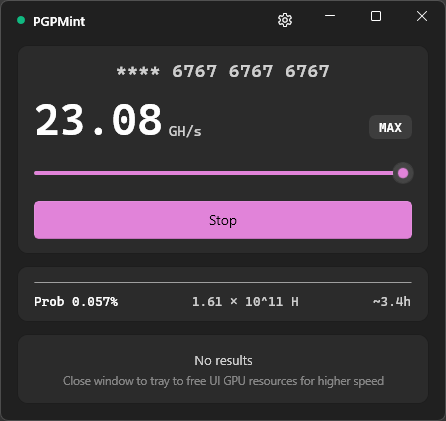
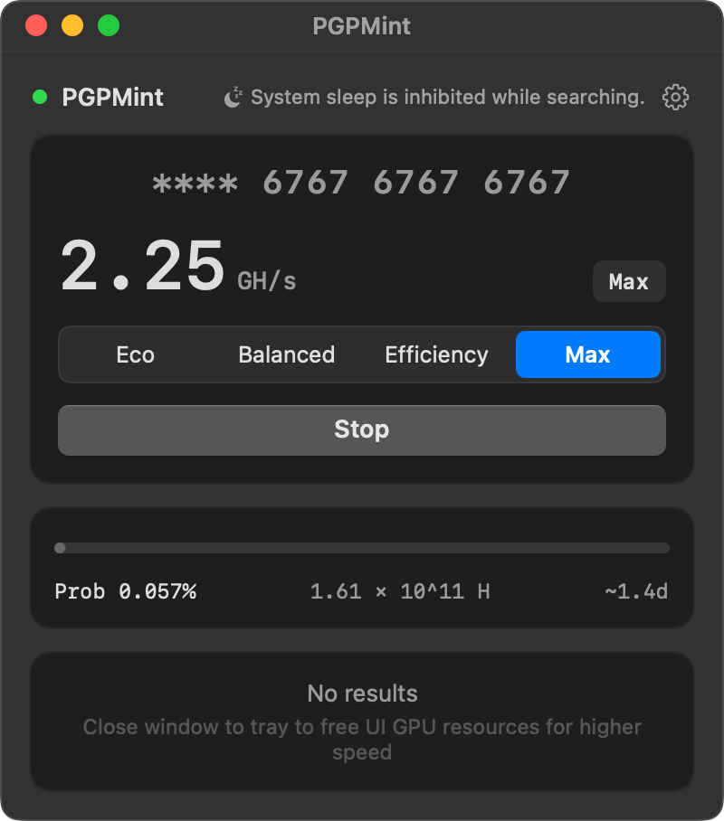
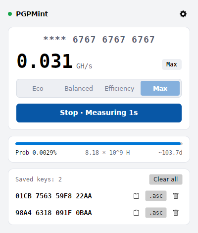
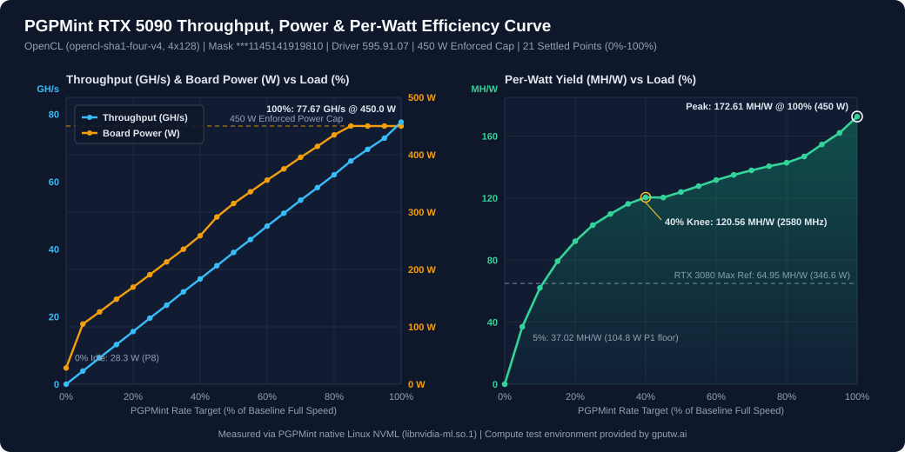

<div align="center">

# PGPMint

[English](README.md) | 繁體中文 | [简体中文](README.zh-CN.md) | [日本語](README.ja.md)

**使用顯示卡算力產生自訂樣式的 OpenPGP v4（`Ed25519`）個人化 Key ID，提供 Windows、macOS、Linux 原生桌面應用與跨平台命令列工具。**

[](https://github.com/Evanlau1798/PGPMint/actions/workflows/ci.yml)
[](https://github.com/Evanlau1798/PGPMint/releases)
[](LICENSE)
[](#支援平台與-cli)
[](#系統需求與建置)

[核心特色](#核心特色) · [效能與功耗基準](#效能與功耗基準) · [下載與快速上手](#下載與快速上手) · [Git 簽章](#搭配-git-簽章) · [支援平台與 CLI](#支援平台與-cli) · [系統需求與建置](#系統需求與建置)

<br />

<table>
  <tr>
    <td align="center" width="33%">
      <br />
      <sub><strong>Windows 11（WinUI 3 + Mica）</strong></sub>
    </td>
    <td align="center" width="33%">
      <br />
      <sub><strong>macOS（原生 SwiftUI / AppKit）</strong></sub>
    </td>
    <td align="center" width="33%">
      <br />
      <sub><strong>Linux（Avalonia 12.2.0 / X11）</strong></sub>
    </td>
  </tr>
</table>

*PGPMint 於 Windows、macOS 與 Linux 跨平台以顯示卡搜尋自訂 OpenPGP v4 Key ID 與校準功耗檔位。*

</div>

---

## 核心特色

PGPMint 利用顯示卡高速產生 **OpenPGP v4（`Ed25519Legacy`）** 金鑰，使 16 碼十六進位 Key ID 符合任何指定樣式——全程離線執行、零遙測上傳。

- **免環境設定的多顯卡通用引擎**：提供 Windows 免安裝單檔 `.exe` 與 macOS / Linux 獨立執行套件，支援 `Vulkan -> OpenCL -> DirectCompute` 自動降級與原生 Apple `Metal`，每次命中皆於 CPU 進行 SHA-1 雙重核實。
- **任意位置 `*` 萬用字元與時間區間**：支援 1–16 碼尾綴（`6767 6767 6767`）、前綴（`DEAD************`）、中段 `*` 萬用字元（`CAFE*123`），以及選填的 UTC 建立時間範圍（寬度至少 7 天）。
- **4 段實測功耗檔位與 NVML 軟限溫**：自動完成 30 秒全曲線校準後可即時切換 `節能`、`平衡`、`效率`、`全速`，可對 3D 程式彈性讓道，並支援 NVML 即時功耗（`W`、`MH/W`）與閉迴路限溫保護（桌面 `70–90 C` / CLI `65–90 C`）。
- **跨機進度與金鑰加密同步（`.pgpmint-sync`）**：以 `SessionId` 累計帳本實現冪等進度匯入（支援運行中熱匯入與重複匯入不重複計算），搭配 Argon2id + AES-256-GCM 加密打包已命中金鑰。
- **加密保險箱與 Git 就緒 `.asc` 匯出**：本機採用 DPAPI / Argon2id 加密儲存（上限 50 筆），匯出符合 RFC 9580 / GnuPG 的金鑰檔（`Certify | Sign`，預設附帶 `Cv25519` 加密子金鑰，支援到期日與 AES-256-CFB 密碼）。
- **常駐背景與 10 國語系**：支援系統匣／選單列背景運行、系統防休眠（`IOKit` / `systemd-inhibit`）、Windows 純 CPU 浮動微窗與 10 種內建語言（CLI 維持英文以利腳本一致性）。

---

## 效能與功耗基準

各平台顯示卡於 `v4` 運算管線之持續實測算力（RTX 5090 與 RTX 3090 系列皆於 Linux 搭配 `libnvidia-ml.so.1` 以 13 碼遮罩 `***1145141919810` 量測；算力致謝見[致謝與雲端 GPU 使用警示](#致謝與雲端-gpu-使用警示)）：

| 裝置 / 作業系統 | 後端 | 持續算力（全速） | 功耗 / 每瓦能效 | 備註 |
|---|---|---|---|---|
| **RTX 5090（Linux x64，450 W 上限）** | **OpenCL**（`4x128`） | **76.18–77.67 GH/s** | `450.0 W`（**`172.61 MH/W`**） | 微基準最高 `83.93 GH/s`（`wg=64`）；180 秒穩態 `74.70 GH/s` |
| **RTX 3090 x2 NVLink（Linux x64）** | **OpenCL**（`4x128`） | **49.43–50.41 GH/s** | `598.8 W`（`82.54 MH/W`） | 雙卡合計 `600 W` 上限（`2.03x` 擴展）；60 秒穩態 `46.42 GH/s` |
| **RTX 3090（Linux x64）** | **OpenCL**（`4x128`） | **25.51–25.93 GH/s** | `298.7 W`（**`85.42 MH/W`**） | `300 W` 上限；60 秒 `25.10 GH/s @ 66–70 C`（`0/60` 熱降頻） |
| **RTX 3080（Windows 11 x64）** | **Vulkan**（`4x128`） | **22.51–23.23 GH/s** | `346.6 W`（`64.95 MH/W`） | OpenCL `23.19 GH/s`、D3D11 `14.38 GH/s` 後備 |
| **Apple M3（macOS 15.6.1）** | **MoltenVK** | **約 2.25 GH/s** | — | Apple Silicon 原生側載背景助手實測 |
| **Intel Alder Lake UHD（Rocky 9.8）** | **Vulkan** | **566.99 MH/s** 峰值 | — | 校準中位 `561.90 MH/s`（Mesa 25.2.7） |

<p align="center">
  
</p>

完整 21 點穩態數據、60 秒 / 180 秒穩定性紀錄與各代核心演化詳見 **[guides/benchmarks.md](guides/benchmarks.md)**（英文）。

<details>
<summary><strong>展開檢視：平均預期等待時間（以 20 GH/s 估算）</strong></summary>

| 固定比對長度 | 搜尋空間（$16^k$） | 平均預期時間 |
|---:|---:|---:|
| 8 碼 | $4.29 \times 10^{9}$ | 約 0.2 秒 |
| 10 碼 | $1.10 \times 10^{12}$ | 約 55 秒 |
| 12 碼 | $2.81 \times 10^{14}$ | 約 3.9 小時 |
| 13 碼 | $4.50 \times 10^{15}$ | 約 2.6 天 |
| 14 碼 | $7.21 \times 10^{16}$ | 約 41.7 天 |

</details>

<details>
<summary><strong>展開檢視：與同類工具功能比較</strong></summary>

| 功能特性 | PGPMint | CLI CUDA 工具 | CLI OpenCL 工具 | 瀏覽器 WebGL/WebGPU |
|---|---|---|---|---|
| 原生桌面介面與系統匣／選單列 | 是（WinUI 3 / SwiftUI / Avalonia） | 否 | 否 | 瀏覽器分頁（背景會降速） |
| 免裝 Python / CUDA Toolkit | 是（獨立套件／單檔執行檔） | 需裝 CUDA | 需裝 Runtime | 是 |
| 多層通用顯卡後備切換 | Vulkan + OpenCL + DirectCompute / Metal | 僅 NVIDIA | 需 OpenCL ICD | 受限於瀏覽器 |
| 多顯卡＋功耗效率檔位 | 是（`節能` / `平衡` / `效率` / `全速`） | 僅全速 | 僅全速 | 有限 |
| 加密金鑰庫與 Git `.asc` 匯出 | 是（DPAPI / Argon2id + 自簽 + `Cv25519`） | 原始匯出 | 原始匯出 | 手動下載 |

</details>

---

## 下載與快速上手

1. 前往 [GitHub Releases](https://github.com/Evanlau1798/PGPMint/releases) 下載對應平台檔案：
   - **Windows GUI**：`PGPMint-*-win-x64.exe` 或 `PGPMint-*-win-arm64.exe`（免安裝單檔）
   - **Windows CLI**：`PGPMint-cli-*-win-x64.exe` 或 `PGPMint-cli-*-win-arm64.exe`（免安裝單檔）
   - **macOS**：`PGPMint-*-macos-arm64.tar.gz` 或 `PGPMint-*-macos-x64.tar.gz`（含 `PGPMint.app` 與 CLI）
   - **Linux**：`PGPMint-*-linux-x64.tar.gz` 或 `PGPMint-*-linux-arm64.tar.gz`（含 `PGPMint.Desktop` 與 CLI）
2. **初始設定**：輸入 1–16 碼十六進位 Key ID 樣式（`0–9`、`A–F` 或 `*` 萬用字元如 `CAFE*123`），勾選實體顯示卡與語言完成精靈。
3. **自動校準與搜尋**：點擊「開始」會自動完成 30 秒校準（期間命中一樣即時核實保存）；之後可隨時切換四段功耗檔位、安全「停止」保存進度，或關閉視窗駐留背景搜尋。
4. **匯出金鑰**：在結果清單點擊 `.asc` 即可匯出 `<KEYID>.secret.asc` 與 `<KEYID>.public.asc`（預設包含 `Cv25519` 加密子金鑰）。

---

## 搭配 Git 簽章

匯出的金鑰包含自簽使用者 ID 與 `Certify | Sign`（`0x03`）權限，可直接用於 GnuPG、Git 與 GitHub Verified 提交驗證：

```powershell
gpg --import <KEYID>.secret.asc
git config --global user.signingkey <KEYID>
git config --global commit.gpgsign true
# 將 <KEYID>.public.asc 內容新增至 GitHub -> Settings -> SSH and GPG keys
```

---

## 支援平台與 CLI

| 平台目標 | 介面與執行架構 | 顯示卡後端 | 金鑰庫保護 | 背景運行與系統控制 |
|---|---|---|---|---|
| **Windows**（`x64` / `ARM64`） | 原生 WinUI 3 + Mica 單檔 `.exe` | Vulkan -> OpenCL -> DirectCompute | DPAPI（`CurrentUser`） | 零佔用系統匣＋純 CPU 浮動微窗 |
| **macOS 14+**（`arm64` / `x64`） | 原生 SwiftUI / AppKit + `.NET 10` 背景助手 | Metal + MoltenVK Vulkan | 登入鑰匙圈或密碼（Argon2id） | 選單列即時算力＋`IOKit` 防休眠 |
| **Linux**（`x64` / `ARM64`） | Avalonia 12.2.0 XAML（`X11` / `XWayland`） | Vulkan + OpenCL | Argon2id + AES-256-GCM | `StatusNotifierWatcher` 系統匣＋`systemd-inhibit` |
| **CLI**（跨三平台） | 無頭命令列執行檔（`pgpmint`） | 依作業系統支援 | Argon2id + AES-256-GCM / 鑰匙圈 | `--tier`、`--max-temp`、`--keep-running`、`sync`、`curve` |

<details>
<summary><strong>展開檢視：macOS 與 Linux 安裝與權限須知（簽章、鑰匙圈、0700 / ACL 與驅動）</strong></summary>

- **macOS 簽章與管線隔離**：發行版採 ad-hoc 簽章（未公證），首次開啟可能需至「系統設定 -> 隱私權與安全性」允許執行。SwiftUI 介面透過匿名 `stdin`/`stdout` NDJSON 管線驅動 `pgpmint-host`，私密種子絕不跨程序傳給介面層。
- **macOS 鑰匙圈與備份**：新建 macOS 桌面金鑰庫以登入鑰匙圈自動解鎖，既有密碼庫維持密碼輸入。備份時請保存完整目錄（含 `vault.key.json` / `vault.unlock.json` 與鑰匙圈密鑰），並另外匯出帶密碼 `.asc` 檔作可攜備份。
- **Linux 驅動需求**：內附 `.NET` 執行環境無法取代顯示卡驅動，使用桌面版需具備 X11 / XWayland 與硬體 Vulkan 1.1+ 或 OpenCL ICD 驅動（詳細相依套件見壓縮包 `TESTING.txt`）；CLI 可於無頭終端直接執行。
- **目錄權限與獨佔鎖**：Unix 自訂目錄須事先設為 `0700`，macOS 會拒絕含顯式或繼承 ACL 的路徑。桌面端與 CLI 透過獨佔 `VaultSession` 互斥（Windows CLI / Avalonia 獨立使用 `%LOCALAPPDATA%\PGPMint-Portable\`，與 WinUI DPAPI 區隔）。

</details>

<details>
<summary><strong>展開檢視：CLI 常用指令速查（devices / verify / search / curve / sync / export）</strong></summary>

```sh
./pgpmint devices --json
./pgpmint verify --backend vulkan        # Windows、Linux Vulkan 或 macOS MoltenVK
./pgpmint verify --backend metal         # macOS 原生 Metal
./pgpmint search --pattern "CAFE*123" --tier efficiency --max-temp 80 --keep-running
./pgpmint curve --backend opencl --pattern BEEF
./pgpmint sync export --output ./bundle.pgpmint-sync
./pgpmint export --key YOUR_KEY_ID --name "Your Name" --output ./exported
```

自動化腳本可使用 `--password-stdin`（第 1 行為金鑰庫密碼、第 2 行為 `export` 保護密碼；macOS 鑰匙圈庫執行 `export` 時第 1 行即作為 `.asc` 密碼），切勿將密碼寫入命令列參數。

</details>

完整安全規範、備份還原規則與全參數清單請參閱 **[guides/platforms-and-cli.md](guides/platforms-and-cli.md)**（英文）。

---

## 系統需求與建置

- **Windows**：Windows 10（組建 19041 / 2004 以上）或 Windows 11（`x64` / `ARM64`），配備 Direct3D 11 Feature Level 11.0+ 實體顯示卡（建議安裝 Vulkan 1.1+ 或 OpenCL 驅動）。
- **macOS**：macOS 14 Sonoma 以上（`Apple Silicon arm64` 或 `Intel x64`），支援 Metal / MoltenVK 實體顯示卡。
- **Linux**：X11 或 XWayland 工作階段（無頭模式可執行 CLI）與硬體 Vulkan 1.1+／OpenCL ICD 驅動。

<details>
<summary><strong>展開檢視：從原始碼建置與打包（.NET 10 SDK）</strong></summary>

需安裝 [.NET 10 SDK](https://dotnet.microsoft.com/download/dotnet/10.0)，並依目標平台準備 Windows 10/11 SDK（`10.0.26100.0`）或 Xcode Command Line Tools：

```powershell
dotnet build PGPMint.sln -p:Platform=x64 -c Release
dotnet test tests\PGPMint.Tests\PGPMint.Tests.csproj -p:Platform=x64 -c Release --no-build --filter "Category!=HardwareGpu"
python scripts/packaging/package.py --rid win-x64 --tag v1.3.0 --platform x64 --scratch C:\pgpmint-dist
```

</details>

SHA-1 顯示卡演算管線、30 秒校準與 `.pgpmint-sync` 原理、自訂語系擴充及完整 6 平台打包指令見 **[guides/architecture-and-build.md](guides/architecture-and-build.md)**（英文）。

---

## 致謝與雲端 GPU 使用警示

特別感謝 **[gputw.ai](https://gputw.ai)** 提供 RTX 5090、RTX 3090 與 RTX 3090 x2 NVLink 效能基準測試與算力／每瓦效率曲線量測所需的 GPU 算力支援。

> [!WARNING]
> **雲端／租用 GPU 反挖礦偵測風險提醒**：PGPMint 在搜尋 OpenPGP Key ID 時會執行長時間、高滿載的 GPU SHA-1 雜湊演算（`opencl-sha1-four-v5` / `vulkan-sha1-four-v5`），其運算負載特徵、核心占用與持續功耗曲線與**加密貨幣挖礦（Proof-of-Work Mining）極為相似**。**請勿在未事先確認供應商服務條款（Terms of Service / Acceptable Use Policy）或取得授權的情況下，直接於租用或雲端 GPU 實例啟動長時間計算**，否則極可能觸發供應商後台的疑似挖礦自動偵測機制而導致**帳號遭到封鎖或停權**。

---

## 參與貢獻與授權條款

歡迎提交 Issue、翻譯檔與 Pull Request；送出前請確認測試與 Release 編譯通過且不含表情符號（由 CI 自動檢查）。本專案採用 [MIT License](LICENSE) 授權釋出。
