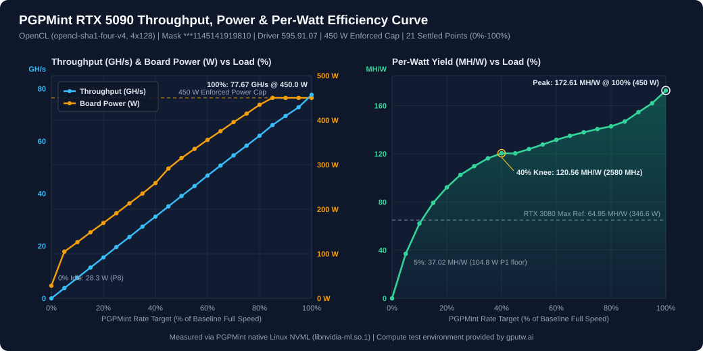

[Back to README](../README.md) | [Platforms & CLI](platforms-and-cli.md) | [Architecture & Build](architecture-and-build.md)

# Benchmarks & Power-Efficiency Data

For compute sponsorship acknowledgements and the Cloud / Rented GPU Anti-Mining Risk Notice, see [Acknowledgements & Cloud GPU Usage Notice](../README.md#acknowledgements--cloud-gpu-usage-notice).

## Multi-GPU Summary

| Device / OS | Backend | Kernel / Workgroup | Micro Median | End-to-End Coordinator (`Max`) | Notes |
|---|---|---|---:|---:|---|
| **RTX 5090 (Linux x64, 450 W Cap)** | **OpenCL** | `opencl-sha1-four-v4` / `64` | **83.93 GH/s** | **76.63 GH/s** | Peak micro throughput (`32 GiB`, Driver `595.91.07`) |
| **RTX 5090 (Linux x64, 450 W Cap)** | **OpenCL** | `opencl-sha1-four-v4` / `128` | **83.32 GH/s** | **76.18 GH/s** | CLI `search` default (`cmem0-v4`; `172.61 MH/W`) |
| **RTX 5090 (Linux x64, 450 W Cap)** | **OpenCL** | `opencl-sha1-four-v4` / `256` | 81.60 GH/s | 75.97 GH/s | — |
| RTX 5090 (Linux x64, 450 W Cap) | Vulkan | `vulkan-sha1-four-v4` / `64`–`256` | 56.75–57.42 GH/s | 54.86–55.03 GH/s | Headless EGL ICD (`nvidia_egl_icd.json`) |
| **RTX 3090 x2 NVLink (Linux x64)** | **OpenCL** | `opencl-sha1-four-v4` / `128` | — | **49.43–50.41 GH/s** | Dual-GPU `600 W` combined cap (`82.54 MH/W`; `46.42 GH/s` 60s steady) |
| **RTX 3090 (Linux x64)** | **OpenCL** | `opencl-sha1-four-v4` / `128` | — | **25.51–25.93 GH/s** | Single GPU (`300 W` cap, `85.42 MH/W`; `25.10 GH/s @ 66–70 C` 60s steady) |
| RTX 3080 (Windows 11 x64) | Vulkan | `vulkan-sha1-four-v4` / `128` | 23.20–23.82 GH/s | 22.51–23.23 GH/s | Full load `346.61 W` (`64.95 MH/W`) |
| Apple M3 (macOS 15.6.1 `macos-arm64`) | MoltenVK | `vulkan-sha1-four-v4` | — | **~2.25 GH/s** | Physical Apple Silicon verification |
| Intel Alder Lake UHD (`ADL GT2`, Rocky Linux 9.8) | Vulkan | Mesa 25.2.7 | — | **566.99 MH/s** peak | `561.90 MH/s` median calibrated |

  

---

## NVIDIA GeForce RTX 5090 (Linux x64, 450 W Enforced Cap)

Measured on an **NVIDIA GeForce RTX 5090** (32 GiB VRAM, Ubuntu 22.04.5 LTS, Driver `595.91.07`, enforced **450.00 W** cap vs `575.00 W` default) using `PGPMint v1.2.1` + native Linux NVML (`libnvidia-ml.so.1`) on the 13-hex suffix `***1145141919810`.

Each point (`100%` `FullSpeed`, `95%`–`5%` under PGPMint 50 ms duty-cycle pacing) settled for 3 s before 5 s steady-state NVML measurement (`0%` = 5 s idle). All search steps counted directly toward persisted progress.

| Target Load | Throughput (GH/s) | Median Power (W) | Yield (MH/W) | GPU Util (%) | Core / Mem Clock (MHz) | Temp (C) | P-State | Power Cap Flags |
|---:|---:|---:|---:|---:|---|---:|:---:|---|
| **100%** | **77.671** | **449.99** | **172.61** | 100 | 2460 / 13801 | 67 | P1 | `SwPowerCap(50/50)` |
| **95%** | 72.912 | 449.94 | 162.05 | 89 | 2610 / 13801 | 69 | P1 | `SwPowerCap(51/51)` |
| **90%** | 69.595 | 450.05 | 154.64 | 85 | 2640 / 13801 | 71 | P1 | `SwPowerCap(52/52)` |
| **85%** | 66.138 | 450.22 | 146.90 | 78 | 2685 / 13801 | 72 | P1 | `SwPowerCap(52/52)` |
| **80%** | 62.075 | 434.58 | 142.84 | 74 | 2707 / 13801 | 73 | P1 | `SwPowerCap(51/51)` |
| **75%** | 58.264 | 414.47 | 140.57 | 69 | 2715 / 13801 | 72 | P1 | `SwPowerCap(52/52)` |
| **70%** | 54.541 | 395.45 | 137.92 | 65 | 2722 / 13801 | 72 | P1 | `SwPowerCap(52/52)` |
| **65%** | 50.677 | 375.36 | 135.01 | 60 | 2737 / 13801 | 72 | P1 | `SwPowerCap(36/52)` |
| **60%** | 46.848 | 355.71 | 131.70 | 55 | 2745 / 13801 | 71 | P1 | `SwPowerCap(15/52)` |
| **55%** | 42.859 | 335.41 | 127.78 | 51 | 2752 / 13801 | 71 | P1 | `SwPowerCap(5/52)` |
| **50%** | 39.055 | 315.02 | 123.98 | 46 | 2767 / 13801 | 69 | P1 | `None` |
| **45%** | 35.103 | 291.53 | 120.41 | 40 | 2767 / 13801 | 70 | P1 | `None` |
| **40%** | 31.205 | 258.84 | 120.56 | 35 | 2580 / 13801 | 67 | P1 | `None` |
| **35%** | 27.370 | 235.32 | 116.31 | 32 | 2565 / 13801 | 65 | P1 | `None` |
| **30%** | 23.404 | 213.20 | 109.78 | 27 | 2550 / 13801 | 64 | P1 | `None` |
| **25%** | 19.584 | 190.85 | 102.61 | 23 | 2542 / 13801 | 61 | P1 | `None` |
| **20%** | 15.601 | 169.27 | 92.17 | 19 | 2527 / 13801 | 60 | P1 | `None` |
| **15%** | 11.745 | 148.12 | 79.30 | 13 | 2520 / 13801 | 58 | P1 | `None` |
| **10%** | 7.832 | 126.09 | 62.12 | 9 | 2505 / 13801 | 57 | P1 | `None` |
| **5%** | 3.879 | 104.79 | 37.02 | 5 | 2497 / 13801 | 55 | P1 | `None` |
| **0% (Idle)** | 0.000 | 28.32 | — | 0 | 195 / 405 | 52 | P8 | `None` |

- **Why `100%` (`Max`) peaks at `172.61 MH/W`**: Under the 450 W power limit, continuous full load settles around `2460 MHz` with ~2.66x the RTX 3080's per-watt yield (`64.95 MH/W`). Below `100%`, PGPMint's 50 ms duty-cycle pacing keeps GDDR7 at `13801 MHz` in `P1` (~105 W static floor at 5%), while `85%–95%` short bursts boost higher (`2610–2685 MHz`) and still saturate `450 W`. At `40%`, the core drops from `2767` to `2580 MHz`, cutting `32.7 W` and forming a slight efficiency knee (`120.56 MH/W`).
- **Plotted 4-Tier Operating Points (`EfficiencyCurveSelector`)**: RTX 5090 (with high-idle-power-floor `Eco` adaptation): `Eco` (`10%`) `7.83 GH/s @ 126.09 W` (`62.12 MH/W`), `Balanced` (`40%`) `31.20 GH/s @ 258.84 W` (`120.56 MH/W`), `Efficiency` (`70%`) `54.54 GH/s @ 395.45 W` (`137.92 MH/W`), `Max` (`100%`) `77.67 GH/s @ 450.00 W` (`172.61 MH/W`); RTX 3080 (Windows Vulkan): `Eco` (`11%`) `2.71 GH/s @ 56.47 W` (`48.03 MH/W`), `Balanced` (`23%`) `5.39 GH/s @ 108.99 W` (`49.42 MH/W`), `Efficiency` (`67%`) `15.88 GH/s @ 301.49 W` (`52.69 MH/W`), `Max` (`100%`) `22.51 GH/s @ 346.61 W` (`64.95 MH/W`).
- **Live 4-Tier Coordinator Validation (5 s settle + 10 s `MultiGpuCoordinator`, v1.2.1 baseline)**: `Max` `76.680 GH/s @ 449.99 W` (`170.40 MH/W`), `Efficiency` (`62.6%`) `49.743 GH/s @ 362.77 W` (`137.12 MH/W`), `Balanced` (`31.3%`) `24.242 GH/s @ 217.69 W` (`111.36 MH/W`), `Eco` (`7.7%`) `6.136 GH/s @ 115.89 W` (`52.95 MH/W`).
- **180-Second Sustained `Max` Stability**: Mean **`74.695 GH/s`** (median **`74.726 GH/s`**, UI rolling window `76.1 -> 74.4 GH/s`), mean power **`448.71 W`** (**`166.47 MH/W`**), temperature stabilizing `70 C -> 80 C` (`0/180` thermal throttling, `179/180` `SwPowerCap`).

---

## NVIDIA GeForce RTX 3090 x2 NVLink & Single-GPU (OpenCL, 4x128, 300 W/GPU Cap)

### RTX 3090 x2 NVLink Multi-GPU Summary

- **Hardware & Topology**: 2x NVIDIA GeForce RTX 3090 (24 GiB each, 4-lane NVLink `NV4`, enforced `300.00 W` cap per card = `600.00 W` combined vs `350 W x2` stock), Ubuntu 22.04.5 LTS, Driver `595.99.02`.
- **Single vs Dual-GPU Scaling**: 1x RTX 3090 standalone `24.289 GH/s` (`299.1 W`, `81.20 MH/W`); 2x RTX 3090 30 s calibration `50.414 GH/s` (`GPU 0`: `25.042 GH/s`, `GPU 1`: `25.372 GH/s`, **`2.03x`** scaling on settled `Max` `49.429 GH/s @ 598.83 W` / `82.54 MH/W`).
- **4-Tier Operating Points (`power_curve_settled.csv`)**: `Eco` (`5%`, `power-floor-fallback`) `2.52 GH/s @ 277.99 W` (`9.08 MH/W`), `Balanced` (`15%`) `7.56 GH/s @ 319.29 W` (`23.68 MH/W`), `Efficiency` (`55%`) `27.06 GH/s @ 523.91 W` (`51.64 MH/W`), `Max` (`100%`) `49.43 GH/s @ 598.83 W` (`82.54 MH/W`). Because P-State `P2` keeps idle floor at `278 W` (`46.4%` of `600 W`), `IsHighIdlePowerFloor` automatically surfaces the `Max`-tier recommendation hint.
- **60-Second Sustained `Max` Stability**: Mean **`46.416 GH/s @ 550.6 W` (`84.31 MH/W`)** as stacked-slot `GPU 0` reaches thermal steady-state (`82–83 C`, `299 -> 242 W`) while `GPU 1` remains at `66 C / 299 W`.

### RTX 3090 Single-GPU Summary

- **Hardware & Power Limit**: Standalone NVIDIA GeForce RTX 3090 (24 GiB VRAM, enforced **`300.00 W`** cap vs `420.00 W` default), Ubuntu 22.04.5 LTS, Driver `595.99.02`.
- **Calibration & 21-Point Curve**: 30 s calibration peaked at **`26.037 GH/s`** (median **`25.933 GH/s @ 298.52 W`**); settled `100%` hit **`25.511 GH/s @ 298.65 W` (`85.42 MH/W`)** while idle at `P8` dropped to `36.39 W`. Compared to RTX 3080 (`22.51 GH/s @ 346.61 W` / `64.95 MH/W`), the `300 W`-capped RTX 3090 delivers **`+13.3%` throughput** at **`-48 W` lower draw** (**`+31.5%` higher yield**).
- **4-Tier Operating Points (`power_curve_settled.csv`)**: `Eco` (`5%`, `power-floor-fallback`) `1.30 GH/s @ 147.79 W` (`8.81 MH/W`), `Balanced` (`10%`) `2.60 GH/s @ 159.45 W` (`16.33 MH/W`), `Efficiency` (`45%`) `11.73 GH/s @ 254.96 W` (`46.01 MH/W`), `Max` (`100%`) `25.51 GH/s @ 298.65 W` (`85.42 MH/W`). Because P-State `P2` pins low-load draw at `147.8 W` (`49.5%` of `300 W`), `IsHighIdlePowerFloor` automatically triggers the `Max`-tier recommendation hint.
- **60-Second Sustained `Max` Stability**: Mean **`25.095 GH/s`** (median **`25.276 GH/s`**) at **`298.91 W`** (**`83.96 MH/W`**), stabilizing at **`66 -> 70 C`** with **`0/60` thermal throttling** (avoiding the stacked-slot throttling seen on dual-card `GPU 0`).

---

## RTX 3080 Backend Comparison & Kernel Evolution (Windows 11 x64)

Measured on an **NVIDIA GeForce RTX 3080** (Windows 11 x64, WDDM driver `32.0.16.1088`, Release x64, `Max` tier), covering host Ed25519 key generation, SHA-1 schedule precomputation, GPU dispatch, and readback (16 warmup + 31 timed FindOne dispatches, 8-hex and 16-hex suffixes, plus 5 s end-to-end `MultiGpuCoordinator` + `KeySchedulePool`):

| Backend | Kernel | 134M Batch Median | 536M Batch Median | End-to-End Coordinator (`Max`) |
|---|---|---:|---:|---:|
| Native Vulkan (`vulkan-1.dll`) | `vulkan-sha1-four-v4` (`ubo-spirv-v4`) | **5.63–6.12 ms** (`21.93–23.82 GH/s`) | **23.11–23.14 ms** (`23.20–23.24 GH/s`) | **23.23 GH/s** |
| Native OpenCL (`OpenCL.dll`) | `opencl-sha1-four-v4` (`cmem0-v4`) | **5.68–6.27 ms** (`21.42–23.61 GH/s`) | **23.78–23.92 ms** (`22.44–22.58 GH/s`) | **23.19 GH/s** |
| DirectCompute (`D3D11 cs_5_0`) | `d3d11-sha1-four-v4` (`cb1-v4`) | **9.14–9.44 ms** (`14.21–14.69 GH/s`) | **37.33–37.38 ms** (`14.36–14.38 GH/s`) | Fallback tier |

- **Concurrent 3D / Video Contention**: Under concurrent dual-stream NVDEC hardware video decoding (3%–11% decoder load), counterbalanced 2-round `MultiGpuCoordinator` averages held **21.35 GH/s** (`-8.08%`) on Vulkan vs **18.98 GH/s** (`-18.14%`) on OpenCL, making Vulkan the default Tier-1 desktop backend.
- **Historical Baselines**: Earlier RTX 3080 iterations progressed from `v1` (`21.06 GH/s` tray / `20.00 GH/s` foreground on OpenCL `opencl-sha1-four-v1`, `13.51 GH/s` on DirectCompute `d3d11-sha1-four-v1`) through `v3` (`ad24a05`: `6.97–7.44 ms` OpenCL vs `10.40–10.74 ms` DirectCompute on 134M batches) to the `v4` zero-spill register/constant-memory design and `v5` wildcard/prefix support.

---

## Expected Average Wait Time & Comparison

### Expected Average Wait Time (at 20 GH/s)

| Pattern Fixed Length | Search Space ($16^k$) | Expected Average Time |
|---:|---:|---:|
| 8 hex chars | $4.29 \times 10^{9}$ | ~0.2 s |
| 10 hex chars | $1.10 \times 10^{12}$ | ~55 s |
| 12 hex chars | $2.81 \times 10^{14}$ | ~3.9 hours |
| 13 hex chars | $4.50 \times 10^{15}$ | ~2.6 days |
| 14 hex chars | $7.21 \times 10^{16}$ | ~41.7 days |

### Comparison with Alternatives

| Capability | PGPMint | CLI CUDA Tools | CLI OpenCL Tools | Browser WebGL/WebGPU |
|---|---|---|---|---|
| Native Desktop UI & Tray / Menu Bar | Yes (WinUI 3 / SwiftUI / Avalonia) | No | No | Browser tab (throttled in background) |
| Zero Python / CUDA Toolkit Setup | Yes (standalone exe / self-contained) | Requires CUDA | Requires runtime | Yes |
| Universal GPU Backend Fallback | Vulkan + OpenCL + DirectCompute / Metal | NVIDIA only | Needs OpenCL ICD | Browser dependent |
| Multi-GPU + Power-Efficiency Tiers | Yes (`Eco` / `Balanced` / `Efficiency` / `Max`) | Full speed only | Full speed only | Limited |
| Encrypted Vault + Git-Ready `.asc` | Yes (DPAPI / Argon2id + self-sig + `Cv25519`) | Raw export | Raw export | Manual download |
